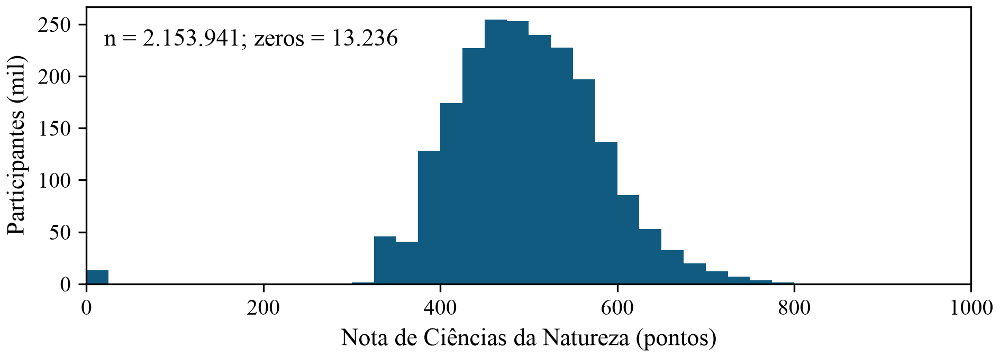
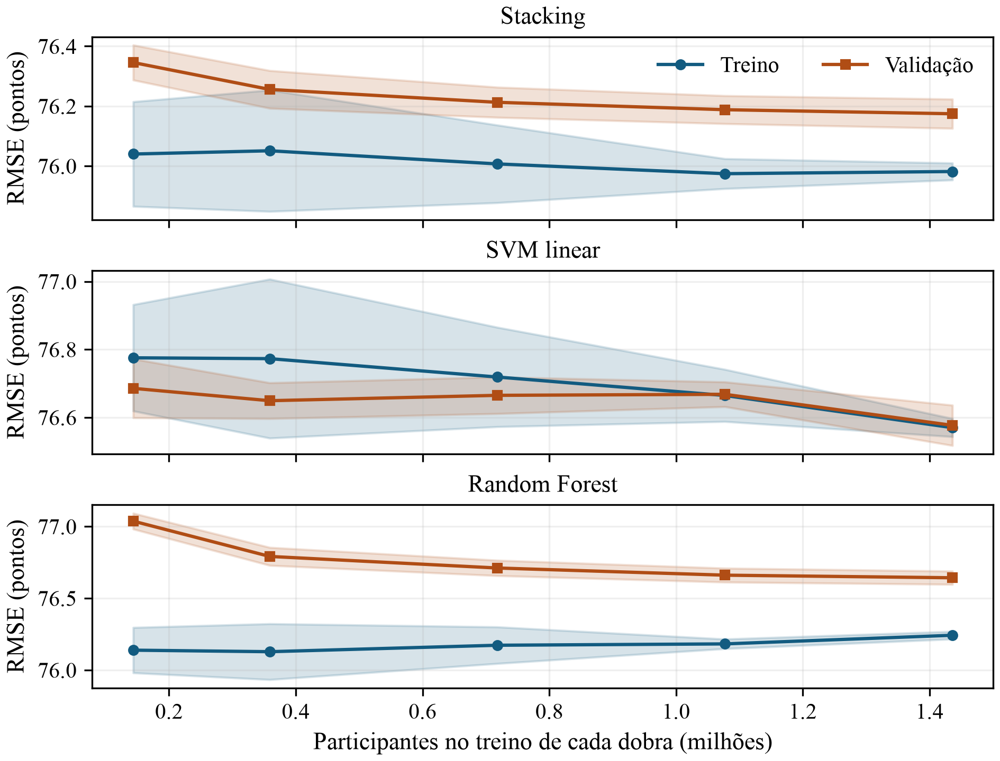
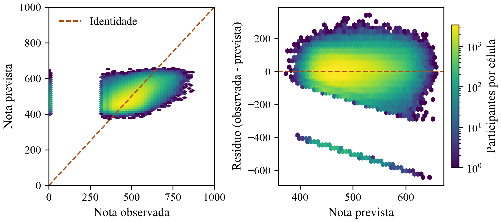

# Comparação nacional de modelos de aprendizado de máquina para estimar a nota de Ciências da Natureza no ENEM 2023

Joey Alan de Freitas Solis; Paulo Henrico
Universidade de Fortaleza (Unifor)
Professor: Tulio
https://github.com/JoeyAlanS/trab2-aprendizado-de-maquina

## Resumo

Este trabalho compara dez regressores para estimar a nota de Ciências da Natureza no ENEM 2023 a partir do perfil socioeconômico, escolar e demográfico, usando a média do treino como baseline. Dos 3.933.955 participantes da fonte nacional, 2.692.427 possuem alvo observado; as notas zero foram mantidas. Reservaram-se 20% dos elegíveis para teste e utilizaram-se três dobras nos 80% de desenvolvimento. Foram avaliados linear sem regularização, Ridge, árvore, SVM linear, KNN, Bagging, Pasting, Random Forest, Gradient Boosting e Stacking. Investigaram-se engenharia e seleção de atributos, PCA, ponderação e duas ablações. O trio inicial do catálogo completo foi Stacking, Ridge e linear; buscas em cinco modelos cobriram 60 configurações e 180 avaliações. A solução foi escolhida no desenvolvimento. No teste de 538.486 participantes, o Stacking obteve RMSE de 76,190 pontos, MAE de 55,325 e R² de 0,2497, reduzindo o RMSE da média em 13,38%. As curvas mostraram pequenas diferenças entre treino e validação nos tamanhos examinados, mas os erros foram maiores nas notas extremas. Os resultados caracterizam generalização entre participantes da mesma edição, sem demonstrar causalidade ou desempenho em outro ano.

Palavras-chave: ENEM; regressão; aprendizado de máquina; comparação de modelos; generalização.

## 1 Introdução e objetivos

Os microdados do ENEM permitem investigar associações entre o perfil dos participantes e seus resultados educacionais (Inep, 2023). Pergunta-se quanto esse perfil permite estimar a nota de Ciências da Natureza, sem utilizar notas de outras provas. O objetivo geral é comparar o catálogo obrigatório de regressores em escala nacional. Os objetivos específicos são examinar representações alternativas, ajustar hiperparâmetros dos modelos mais promissores, analisar curvas de aprendizado e descrever erros por faixa de nota e tipo de escola. A contribuição consiste em uma comparação reproduzível, incluindo resultados sem melhoria. Seu uso proposto é acadêmico e exploratório; não se estimam efeitos causais nem se propõe decidir sobre participantes individualmente.

## 2 Fundamentação e configurações iniciais

A regressão linear combina atributos por coeficientes ajustados ao erro quadrático; Ridge acrescenta uma penalização L2 para controlar sua magnitude. A árvore divide o espaço dos atributos em regiões de predição constante. O baseline DummyRegressor(strategy="mean") prevê a média do alvo aprendida no treino, sem utilizar as features. As implementações baseiam-se no ecossistema scikit-learn (Pedregosa et al., 2011; Scikit-learn, 2026c).

A SVM de regressão combina regularização e perda insensível a erros até epsilon; adotou-se LinearSVR, com função linear, pelo custo da população nacional. O KNN utiliza 25 vizinhos e ponderação inversa à distância euclidiana (Scikit-learn, 2026d, 2026e). A implementação do projeto realiza busca exata: o índice binário Faiss examina exaustivamente os indicadores categóricos, e a parcela numérica usa precisão dupla, preservando a distância, sem amostragem da população (Douze et al., 2024). O código está em src/enem_base/neighbors.py.

Bagging agrega árvores treinadas em amostras com reposição; Pasting usa amostras sem reposição. Random Forest acrescenta aleatoriedade na escolha dos atributos das divisões. Gradient Boosting constrói árvores sequenciais para reduzir a perda. Stacking aprende a combinação das previsões de modelos distintos; o combinador recebe previsões fora da dobra interna, evitando que aprenda apenas com respostas ajustadas aos mesmos exemplos (Scikit-learn, 2026b).

Quadro 1 - Configurações iniciais de SVM, KNN e ensembles

| Modelo | Parâmetros principais |
| --- | --- |
| SVM | LinearSVR; C=1; epsilon=0; tol=0,001; 5.000 iterações |
| KNN | 25 vizinhos; pesos inversos à distância euclidiana |
| Bagging | 20 árvores; profundidade 8; amostra de 70%, com reposição |
| Pasting | Mesmos parâmetros do Bagging, sem reposição |
| Random Forest | 30 árvores; profundidade 12; max_features=0,8 |
| Boosting | 60 estágios; profundidade 2; taxa de aprendizado 0,1 |
| Stacking | Linear + árvore (profundidade 12); combinador Ridge alpha=1; três dobras internas |

Fonte: configurações executadas no projeto. Semente 42 quando aplicável; todas as árvores têm folha mínima de 100 participantes.

Linear sem regularização (tol=10⁻⁶), Ridge (alpha=1, solver lsqr, tol=10⁻⁵) e árvore isolada (profundidade 12, folha mínima 100) também integram o catálogo obrigatório. Os limites das árvores e dos ensembles restringem complexidade e custo. Todos os regressores usam as mesmas entradas e partições; suas diferenças de desempenho referem-se às configurações examinadas.

## 3 Metodologia experimental

### 3.1 População, fonte e atributos

O arquivo nacional do Inep (2023) contém 3.933.955 registros e 76 colunas. A supervisão inclui 2.692.427 participantes com NU_NOTA_CN observada e mantém os 16.547 zeros. Os 1.241.528 alvos ausentes são excluídos apenas da modelagem supervisionada. Não há exclusão por idade, condição de treineiro ou notas de outras áreas. A Figura 1 apresenta a distribuição no desenvolvimento.

Fonte: elaboração própria sobre os microdados do Inep (2023); intervalos de 25 pontos; conjunto de teste excluído.

São utilizados 40 atributos originais: Q005 numérico e 39 categóricos, abrangendo questionário socioeconômico, características demográficas e escolares, língua escolhida e UF da prova. Esta última não representa necessariamente a residência. Identificadores, presença, notas, respostas, gabaritos e resultados da redação não são preditores. O complemento de competências da redação foi preservado como fonte auxiliar, sem junção à matriz de atributos.

Os ZIPs originais passaram por CRC. A comparação integral do CSV normalizado confirmou igualdade com os 79 Parquets usados nos experimentos, preservando dados e partições. Os hashes estão nos manifestos do repositório e documentam identidade local, sem substituir assinatura oficial do fornecedor.

### 3.2 Partições e prevenção de vazamento

A divisão aleatória com semente 42 reservou 2.153.941 participantes para desenvolvimento e 538.486 para teste. O desenvolvimento utiliza KFold com três dobras e embaralhamento: em cada rodada, treina-se em duas partes e valida-se na terceira, até todas serem usadas para validação. IDs e dobras são persistidos. Mediana, parâmetros de escala e vocabulário one-hot são ajustados somente no treino de cada dobra; a ausência categórica usa o marcador fixo __MISSING__. Categorias inéditas são ignoradas pelo codificador. Cada base do Stacking reaprende sua preparação nas três dobras internas.

### 3.3 Representações e hipóteses adicionais

A engenharia criou COMPUTADORES_POR_MORADOR (Q024 ÷ Q005 válida), ACESSO_DIGITAL (computador + internet) e ESCOLARIDADE_PAIS_MAX (máximo ordinal de Q001 e Q002, ambas conhecidas). Quatro ou mais computadores usam o limite inferior quatro; denominadores inválidos e desconhecimento geram ausência. A seleção reteve 75% das colunas codificadas após a engenharia, por f_regression no treino.

PCA projeta os dados em direções de maior variância (Scikit-learn, 2026a). Usou-se PCA centrado na representação codificada, sem reescalar os indicadores one-hot. O limiar de 80% busca compactação, sem garantir retenção da informação preditiva. Foram selecionados 45 de 235 componentes em cada ajuste de Ridge e árvore (Figura 2).

Fonte: Inep (2023); seis ajustes no treino, dois regressores e três dobras. As curvas se sobrepõem nas mesmas entradas.

Tabela 1 - Resultados das representações alternativas no desenvolvimento

| Modelo / representação | RMSE ± DP |
| --- | --- |
| Ridge + engenharia | 76,458 ± 0,053 |
| Ridge + seleção | 76,529 ± 0,054 |
| Árvore + PCA | 78,328 ± 0,037 |
| Ridge + PCA | 77,733 ± 0,069 |
| Ridge + ponderação | 125,202 ± 0,136 |
| Ridge sem bloco socioeconômico | 80,351 ± 0,049 |
| Ridge sem UF da prova | 76,661 ± 0,052 |

Fonte: Inep (2023), experimentos nacionais; RMSE médio ± DP populacional entre três dobras. Ridge original: 76,484 ± 0,054; árvore original: 77,167 ± 0,042.

A ponderação utilizou frequências de dez faixas do treino para priorizar notas raras, mas piorou o RMSE global. As ablações retiraram o bloco socioeconômico ou a UF. Ambas elevaram o erro do Ridge (Tabela 1), indicando contribuição preditiva, sem causalidade.

## 4 Comparação inicial e seleção do trio

O RMSE, raiz do erro quadrático médio, é a métrica principal: mede pontos da nota e penaliza mais os erros grandes. MAE mede erro absoluto médio; R² expressa ajuste relativo à variabilidade. O ranking usa RMSE médio sem arredondamento. O DP populacional das três dobras é descritivo, não intervalo de confiança.

Tabela 2 - Validação cruzada inicial: métricas e tempo observado

| Modelo | RMSE ± DP | MAE ± DP | R² ± DP | Tempo (s) |
| --- | --- | --- | --- | --- |
| Stacking | 76,175 ± 0,049 | 55,356 ± 0,034 | 0,2494 ± 0,0005 | 1742,9 |
| Ridge | 76,484 ± 0,054 | 55,623 ± 0,040 | 0,2433 ± 0,0005 | 57,8 |
| Linear | 76,484 ± 0,054 | 55,623 ± 0,040 | 0,2432 ± 0,0005 | 79,6 |
| SVM linear | 76,577 ± 0,059 | 55,519 ± 0,045 | 0,2414 ± 0,0005 | 46,2 |
| Random Forest | 76,643 ± 0,046 | 55,850 ± 0,029 | 0,2401 ± 0,0006 | 4615,4 |
| Árvore | 77,167 ± 0,042 | 56,290 ± 0,022 | 0,2297 ± 0,0005 | 397,7 |
| Bagging | 77,484 ± 0,029 | 56,657 ± 0,021 | 0,2233 ± 0,0009 | 1005,9 |
| Boosting | 77,589 ± 0,068 | 56,730 ± 0,047 | 0,2212 ± 0,0005 | 535,0 |
| Pasting | 77,609 ± 0,043 | 56,758 ± 0,032 | 0,2208 ± 0,0007 | 1253,9 |
| KNN | 77,896 ± 0,042 | 56,850 ± 0,025 | 0,2150 ± 0,0006 | 2681,7 |
| Média | 87,921 ± 0,078 | 66,240 ± 0,044 | -0,0000 ± 0,0000 | 0,1 |

Fonte: Inep (2023), três dobras. Métricas: média ± DP (ddof=0). Tempo: soma dos tempos de parede das três avaliações; recursos compartilhados, sem benchmark isolado.

Fonte: Inep (2023), desenvolvimento (n=2.153.941). Barras: ±1 DP entre dobras.

O trio inicial do catálogo completo foi Stacking, Ridge e linear. No recorte adicional de sete algoritmos, selecionaram-se Stacking, SVM e Random Forest. As buscas cobriram a união dos dois grupos. Linear, Ridge e árvore isolada possuem treinamento e CV completos. As diferenças são descritivas, sem teste de significância.

## 5 Buscas e congelamento das receitas

As buscas utilizaram GridSearchCV com PredefinedSplit das três dobras persistidas e RMSE como critério principal. Foram avaliadas 12 configurações por modelo, totalizando 60 configurações e 180 avaliações em Stacking, Ridge, linear, SVM e Random Forest. Nenhuma decisão de busca utilizou o teste final.

No Stacking e no Ridge, alpha percorreu {0,001; 0,003; 0,01; 0,03; 0,1; 0,3; 1; 3; 10; 30; 100; 1.000}. Na regressão linear, combinaram-se intercepto ativado/desativado e seis tolerâncias de 10⁻³ a 10⁻⁸. Na SVM, C pertenceu a {0,01; 0,1; 1; 10}, epsilon a {0; 0,1; 1}, com limite de 50.000 iterações na busca. Na Random Forest, combinaram-se profundidades 8 e 12 com 5, 10, 15, 20, 25 e 30 árvores; os demais parâmetros permaneceram fixos.

Fonte: Inep (2023), buscas do projeto. Marcadores sobrepostos refletem ganhos mínimos, não falta de execução.

O Stacking selecionou alpha=1.000 no combinador, com redução de apenas 3,205 × 10⁻⁸ ponto no RMSE médio. Ridge selecionou alpha=10, melhorando 0,0000376 ponto; linear selecionou tolerância 10⁻⁵, melhorando 0,000205 ponto. SVM e Random Forest mantiveram as receitas iniciais. A regra prévia conservava a configuração inicial quando o ganho não superasse 10⁻⁸. Superar esse limiar numérico não demonstra relevância prática ou significância estatística.

As receitas foram congeladas antes das curvas finais e do teste. Conforme o enunciado, o teste incluiu média, linear sem regularização e solução final, acrescido de SVM e Random Forest. A linear de referência manteve tol=10⁻⁶; não corresponde à vencedora da busca linear. A solução escolhida no desenvolvimento foi o Stacking. Ridge, árvore, KNN, Bagging, Pasting e Boosting possuem CV completa, sem avaliação adicional no teste reservado.

As execuções utilizam Python 3.13, scikit-learn 1.9.1 e Faiss 1.15.1, com versões em uv.lock. Cache e retomadas exigem compatibilidade de parâmetros, entradas e hashes. Tempos de parede podem refletir reuso e concorrência; não constituem benchmark isolado. Originais, preparação, partições, código e resultados são separados, com métricas em experimentos.csv e previsões em previsoes_teste.csv.

## 6 Curvas de aprendizado e generalização

As curvas foram produzidas para Stacking, SVM e Random Forest, com configurações congeladas, incluindo o modelo final obrigatório. Usaram-se subconjuntos aleatórios cumulativos de 10%, 25%, 50%, 75% e 100% do treino de cada dobra, semente 42 e validação fixa. São 45 pontos e 15 resumos; o menor treino tem cerca de 143.596 participantes. Transformações são ajustadas no treino correspondente. Pontos finais reaproveitam cálculos compatíveis documentados, sem representar 45 treinamentos inteiramente novos.

Fonte: Inep (2023); resultados validados antes do teste. Linhas: média; faixas: ±1 DP em três dobras. Eixos verticais próprios por modelo. Configurações idênticas permitiram reaproveitar 30 pontos de SVM/Random Forest; os resultados do Stacking foram compatibilizados com o combinador final.

O Stacking mantém o menor RMSE de validação nos cinco tamanhos. Em 100%, as diferenças médias entre validação e treino são 0,193 ponto no Stacking, 0,007 na SVM e 0,400 na Random Forest. Não há separação acentuada que indique forte sobreajuste nesses tamanhos. A estabilização sugere ganhos limitados apenas com mais dados semelhantes, mas não comprova um teto preditivo. R² próximo de 0,25, isoladamente, não demonstra subajuste: atributos disponíveis e variabilidade não observada também limitam a previsão.

## 7 Avaliação final no conjunto de teste

As cinco receitas foram ajustadas no desenvolvimento completo e avaliadas nos mesmos 538.486 participantes do teste (Tabela 3). As métricas foram recompostas das previsões exportadas. O teste não foi utilizado para selecionar atributos, parâmetros ou tamanho de treino; não houve nova seleção após observá-lo. Como o alvo é contínuo, analisaram-se resíduos e erros, sem matrizes de confusão.

Tabela 3 - Métricas finais e tempo de ajuste no desenvolvimento

| Modelo | RMSE | MAE | R² | Ajuste (s) |
| --- | --- | --- | --- | --- |
| Stacking | 76,190 | 55,325 | 0,2497 | 1250,63 |
| Linear (ref.) | 76,517 | 55,616 | 0,2433 | 36,41 |
| SVM linear | 76,622 | 55,538 | 0,2412 | 20,63 |
| Random Forest | 76,658 | 55,821 | 0,2405 | 1280,05 |
| Média | 87,959 | 66,285 | -0,0000 | 0,003 |

Fonte: Inep (2023), teste; n=538.486 para cada modelo. Tempos em segundos, sem incluir predição. Não há DP de dobras nesta avaliação única.

O Stacking apresentou RMSE de 76,189590 pontos, MAE de 55,325018 e R² de 0,249711. Sua redução de RMSE frente à média foi 13,38%. A linear de referência obteve RMSE de 76,516794: diferença de apenas 0,327204 ponto, com ajuste menos custoso nesta execução, sem benchmark isolado. Stacking, SVM e Random Forest mantiveram a ordem observada na validação. A proximidade entre desenvolvimento e teste indica consistência interna nesta edição, sem comprovar desempenho temporal.

Fonte: Inep (2023), todas as 538.486 previsões persistidas; cores em escala logarítmica indicam contagens por célula. À esquerda, identidade; à direita, referência de resíduo zero. Valores em pontos da escala do ENEM.

A Figura 6 mostra previsões concentradas no centro e resíduos com estrutura, incluindo erros negativos nas notas zero. Os extremos são aproximados de valores intermediários, apesar do RMSE global semelhante entre validação e teste.

## 8 Análise crítica, conclusão e trabalhos futuros

A Figura 7 explicita a heterogeneidade dos erros do Stacking. O RMSE é 154,31 pontos abaixo de 400 e 160,74 em notas a partir de 700, contra 48,12 no intervalo [400,500). Os resíduos médios (observado menos previsto) são -118,60 na faixa inferior e +156,03 na superior: há superestimação de notas baixas e subestimação de notas altas. As contagens são necessárias para contextualizar cada comparação.

Fonte: Inep (2023), previsões finais. Escola: códigos 1 (não respondeu), 2 (pública) e 3 (privada), conforme dicionário do Inep. Os grupos cobrem todos os participantes do teste; n indica tamanho do grupo.

As diferenças escolares são descritivas e não isolam composição socioeconômica ou outros fatores. Na ponderação do Ridge, a melhora das faixas extremas na validação veio acompanhada de piora global: o RMSE passou de 76,484 para 125,202. Portanto, equilibrar frequências não foi uma melhoria geral. Engenharia trouxe ganho pequeno; seleção e PCA pioraram as configurações examinadas.

O Stacking teve o menor RMSE de desenvolvimento no catálogo completo e o menor erro entre as receitas avaliadas no teste. O ganho sobre a linear foi pequeno e exige ponderar custo e complexidade. A divisão aleatória em uma única edição, com dados observacionais, autodeclaração e ausências, não avalia mudança temporal ou transferência para escolas inéditas. Estudos futuros devem comparar outras edições, partições por grupos, perdas robustas e intervalos de predição, com novo teste reservado. Essas possibilidades não foram executadas; o resultado atual é uma evidência acadêmica, não uma solução validada para decisões individuais.

## Referências

DOUZE, Matthijs et al. **The Faiss library**. [S. l.]: arXiv, 2024. Preprint, arXiv:2401.08281v1. DOI: 10.48550/arXiv.2401.08281. Disponível em: https://arxiv.org/abs/2401.08281v1. Acesso em: 15 nov. 2026.

INEP - INSTITUTO NACIONAL DE ESTUDOS E PESQUISAS EDUCACIONAIS ANÍSIO TEIXEIRA. **Microdados do Enem 2023**. Brasília, DF: Inep, 2023. Disponível em: https://www.gov.br/inep/pt-br/acesso-a-informacao/dados-abertos/microdados/enem. Acesso em: 15 nov. 2026.

PEDREGOSA, Fabian et al. Scikit-learn: Machine Learning in Python. **Journal of Machine Learning Research**, v. 12, n. 85, p. 2825-2830, 2011. Disponível em: https://jmlr.org/papers/v12/pedregosa11a.html. Acesso em: 15 nov. 2026.

SCIKIT-LEARN. **Decomposing signals in components (matrix factorization problems)**. Documentação, versão 1.9.1. [S. l.]: scikit-learn, 2026a. Disponível em: https://scikit-learn.org/stable/modules/decomposition.html. Acesso em: 15 nov. 2026.

SCIKIT-LEARN. **Ensembles: Gradient boosting, random forests, bagging, voting, stacking**. Documentação, versão 1.9.1. [S. l.]: scikit-learn, 2026b. Disponível em: https://scikit-learn.org/stable/modules/ensemble.html. Acesso em: 15 nov. 2026.

SCIKIT-LEARN. **Linear Models**. Documentação, versão 1.9.1. [S. l.]: scikit-learn, 2026c. Disponível em: https://scikit-learn.org/stable/modules/linear_model.html. Acesso em: 15 nov. 2026.

SCIKIT-LEARN. **Nearest Neighbors**. Documentação, versão 1.9.1. [S. l.]: scikit-learn, 2026d. Disponível em: https://scikit-learn.org/stable/modules/neighbors.html. Acesso em: 15 nov. 2026.

SCIKIT-LEARN. **Support Vector Machines**. Documentação, versão 1.9.1. [S. l.]: scikit-learn, 2026e. Disponível em: https://scikit-learn.org/stable/modules/svm.html. Acesso em: 15 nov. 2026.
