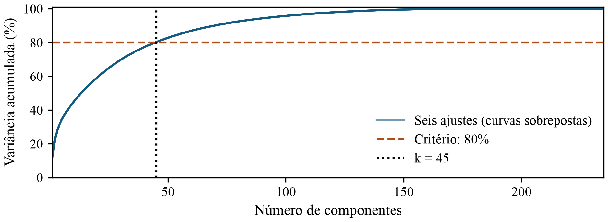
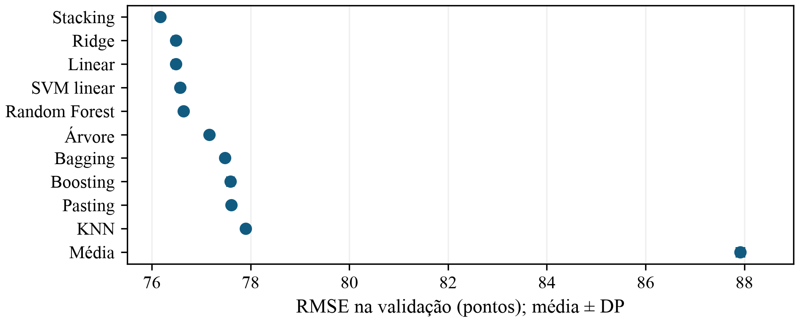
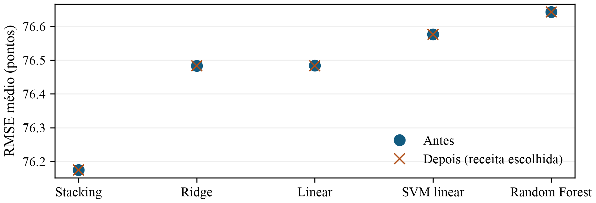
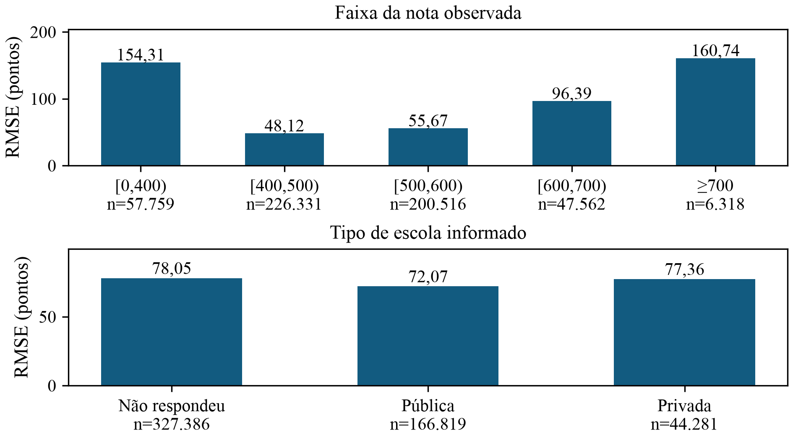

# Comparação nacional de modelos de aprendizado de máquina para estimar a nota de Ciências da Natureza no ENEM 2023

Joey Alan de Freitas Solis; Paulo Henrico
Universidade de Fortaleza (Unifor)
Professor: Tulio
https://github.com/JoeyAlanS/trab2-aprendizado-de-maquina

## Resumo

Este trabalho compara modelos de regressão para estimar a nota de Ciências da Natureza no ENEM 2023 a partir do perfil socioeconômico, escolar e demográfico. Utilizaram-se os microdados nacionais, com 3.933.955 participantes e 76 variáveis na origem, dos quais 2.692.427 possuem alvo observado. Foram mantidas as notas zero e reservados 20% dos participantes elegíveis para teste. SVM linear, KNN, Bagging, Pasting, Random Forest, Gradient Boosting e Stacking foram avaliados nas mesmas três dobras de desenvolvimento, acompanhados de referências simples. Também foram examinadas engenharia e seleção de atributos, análise de componentes principais, ponderação e ablações. Selecionaram-se Stacking, SVM e Random Forest entre os sete algoritmos. As buscas cobriram 60 configurações em cinco modelos, sem consultar o teste. Na avaliação final de 538.486 participantes, o Stacking apresentou RMSE de 76,190 pontos, MAE de 55,325 e R² de 0,2497, reduzindo o RMSE da média de referência em 13,38%. As curvas de aprendizado mostraram pequenas diferenças entre treino e validação nos tamanhos avaliados. Entretanto, os erros foram maiores nos extremos das notas. Os resultados sustentam uma comparação preditiva da mesma edição, sem interpretação causal nem comprovação de generalização temporal.

Palavras-chave: ENEM; regressão; aprendizado de máquina; comparação de modelos; generalização.

## 1 Introdução e objetivos

Os microdados do ENEM permitem estudar relações entre o perfil dos participantes e seus resultados educacionais (Inep, 2023). A pergunta deste trabalho é quanto as informações de perfil permitem estimar a nota de Ciências da Natureza, sem utilizar resultados de outras provas. O objetivo geral é comparar sete famílias de algoritmos em escala nacional. Os objetivos específicos são avaliar representações alternativas, selecionar três modelos, examinar suas curvas de aprendizado e comparar os erros finais por faixa de nota e perfil escolar. O estudo trata de previsão observacional; não estima efeitos de renda ou escola sobre a aprendizagem.

## 2 Fundamentação e configurações iniciais

A regressão linear combina atributos por coeficientes ajustados ao erro quadrático; Ridge acrescenta penalização L2. Uma árvore divide o espaço dos atributos em regiões de predição constante. A média do treino fornece uma referência sem informação de perfil. As implementações utilizam o ecossistema scikit-learn (Pedregosa et al., 2011; Scikit-learn, 2026c).

A SVM de regressão emprega regularização e uma perda insensível a erros dentro de epsilon; adotou-se sua versão linear pelo custo da base nacional. O KNN estima a resposta pelos vizinhos mais próximos, ponderados pela distância (Scikit-learn, 2026d, 2026e). Neste projeto, os 25 vizinhos euclidianos são procurados exatamente, sem amostragem, com índice binário Faiss para os indicadores categóricos e distância numérica em precisão dupla (Douze et al., 2024). A implementação e suas verificações estão em src/enem_base/neighbors.py.

Bagging agrega árvores treinadas em amostras com reposição; Pasting usa amostras sem reposição. Random Forest acrescenta aleatoriedade na escolha dos atributos das divisões. Gradient Boosting constrói árvores sequenciais para reduzir a perda. Stacking aprende a combinação das previsões de modelos distintos; o combinador recebe previsões fora da dobra interna, evitando que aprenda apenas com respostas ajustadas aos mesmos exemplos (Scikit-learn, 2026b).

Quadro 1 - Configurações iniciais dos sete algoritmos

| Modelo | Parâmetros principais |
| --- | --- |
| SVM | LinearSVR; C=1; epsilon=0; tol=0,001; 5.000 iterações |
| KNN | 25 vizinhos; pesos inversos à distância euclidiana |
| Bagging | 20 árvores; profundidade 8; amostra de 70%, com reposição |
| Pasting | Mesmos parâmetros do Bagging, sem reposição |
| Random Forest | 30 árvores; profundidade 12; max_features=0,8 |
| Boosting | 60 estágios; profundidade 2; taxa de aprendizado 0,1 |
| Stacking | Linear + árvore (profundidade 12); combinador Ridge alpha=1; três dobras internas |

Fonte: configurações executadas no projeto. Semente 42 quando aplicável; todas as árvores têm folha mínima de 100 participantes.

Os limites de profundidade e de tamanho dos ensembles restringem a complexidade e o custo computacional. Linear sem regularização, Ridge com alpha=1 e árvore de profundidade 12 complementam o catálogo. A comparação usa as mesmas entradas e partições, embora as famílias tenham capacidades distintas.

## 3 Metodologia experimental

### 3.1 População, fonte e atributos

O arquivo nacional do Inep (2023) contém 3.933.955 registros e 76 colunas. A supervisão inclui 2.692.427 participantes com NU_NOTA_CN observada e mantém os 16.547 zeros. Os 1.241.528 alvos ausentes são excluídos apenas da modelagem supervisionada. Não há exclusão por idade, condição de treineiro ou notas de outras áreas. A Figura 1 apresenta a distribuição no desenvolvimento.

Fonte: elaboração própria sobre os microdados do Inep (2023); intervalos de 25 pontos; conjunto de teste excluído.

São utilizados 40 atributos originais: Q005 numérico e 39 categóricos, abrangendo questionário socioeconômico, características demográficas e escolares, língua escolhida e UF da prova. Esta última não representa necessariamente a residência. Identificadores, presença, notas, respostas, gabaritos e resultados da redação não são preditores. O complemento de competências da redação foi preservado como fonte auxiliar, sem junção à matriz de atributos.

Os ZIPs locais passaram por verificação CRC. O CSV principal tem SHA-256 c8b1fae0a97b6ac826d950d16696efa3d89c133b0165128aadd2997c2315b666. A comparação integral de suas 76 colunas, após normalização, confirmou igualdade com os 79 Parquets usados nos experimentos. Essa conferência preservou os dados preparados e os resultados existentes; o hash documenta identidade local, sem substituir uma assinatura oficial do fornecedor.

### 3.2 Partições e prevenção de vazamento

Foram congelados 2.153.941 participantes para desenvolvimento e 538.486 para teste, na divisão 80/20 com semente 42. O desenvolvimento usa KFold com três dobras, embaralhamento e a mesma semente. IDs e dobras são persistidos. Mediana, padronização de Q005, categoria de ausência e codificação one-hot são aprendidas somente no treino de cada dobra. Categorias inéditas são ignoradas pelo codificador. O Stacking repete esse cuidado em suas três dobras internas.

### 3.3 Representações e hipóteses adicionais

A engenharia criou COMPUTADORES_POR_MORADOR, ACESSO_DIGITAL e ESCOLARIDADE_PAIS_MAX, para representar disponibilidade relativa de recursos e contexto familiar. A categoria de quatro ou mais computadores usa quatro como limite inferior; escolaridade desconhecida permanece ausente. A seleção reteve 75% dos atributos codificados pelo teste F de regressão, ajustado no treino.

PCA projeta os dados em direções de maior variância (Scikit-learn, 2026a). Usou-se PCA centrado na representação codificada, sem reescalar os indicadores one-hot. O limiar de 80% busca compactação, sem garantir retenção da informação preditiva. Foram selecionados 45 de 235 componentes em cada ajuste de Ridge e árvore (Figura 2).

Fonte: Inep (2023); seis ajustes no treino, dois regressores e três dobras. As curvas se sobrepõem nas mesmas entradas.

Tabela 1 - Resultados das representações alternativas no desenvolvimento

| Modelo / representação | RMSE ± DP |
| --- | --- |
| Ridge + engenharia | 76,458 ± 0,053 |
| Ridge + seleção | 76,529 ± 0,054 |
| Árvore + PCA | 78,328 ± 0,037 |
| Ridge + PCA | 77,733 ± 0,069 |
| Ridge + ponderação | 125,202 ± 0,136 |
| Ridge sem bloco socioeconômico | 80,351 ± 0,049 |
| Ridge sem UF da prova | 76,661 ± 0,052 |

Fonte: Inep (2023), experimentos nacionais; RMSE médio ± DP populacional entre três dobras. Ridge original: 76,484 ± 0,054; árvore original: 77,167 ± 0,042.

A ponderação deu peso inverso à frequência de dez faixas de largura igual, definidas no treino, para priorizar notas raras; piorou o RMSE global. As ablações testaram duas hipóteses: retirar o bloco socioeconômico ou a UF aumentaria o erro do Ridge. As duas ablações elevaram o RMSE (Tabela 1), indicando contribuição preditiva, sem estabelecer causalidade.

## 4 Comparação inicial e seleção do trio

RMSE é a raiz da média dos erros quadráticos; MAE é a média dos erros absolutos; R² compara a soma dos erros quadráticos à variação em torno da média observada. O ranking minimiza o RMSE médio sem arredondamento prévio; MAE e R² complementam a avaliação. O desvio padrão (DP) populacional entre três dobras é descritivo, não intervalo de confiança.

Tabela 2 - Validação cruzada inicial: métricas e tempo observado

| Modelo | RMSE ± DP | MAE ± DP | R² ± DP | Tempo (s) |
| --- | --- | --- | --- | --- |
| Stacking | 76,175 ± 0,049 | 55,356 ± 0,034 | 0,2494 ± 0,0005 | 1742,9 |
| Ridge | 76,484 ± 0,054 | 55,623 ± 0,040 | 0,2433 ± 0,0005 | 57,8 |
| Linear | 76,484 ± 0,054 | 55,623 ± 0,040 | 0,2432 ± 0,0005 | 79,6 |
| SVM linear | 76,577 ± 0,059 | 55,519 ± 0,045 | 0,2414 ± 0,0005 | 46,2 |
| Random Forest | 76,643 ± 0,046 | 55,850 ± 0,029 | 0,2401 ± 0,0006 | 4615,4 |
| Árvore | 77,167 ± 0,042 | 56,290 ± 0,022 | 0,2297 ± 0,0005 | 397,7 |
| Bagging | 77,484 ± 0,029 | 56,657 ± 0,021 | 0,2233 ± 0,0009 | 1005,9 |
| Boosting | 77,589 ± 0,068 | 56,730 ± 0,047 | 0,2212 ± 0,0005 | 535,0 |
| Pasting | 77,609 ± 0,043 | 56,758 ± 0,032 | 0,2208 ± 0,0007 | 1253,9 |
| KNN | 77,896 ± 0,042 | 56,850 ± 0,025 | 0,2150 ± 0,0006 | 2681,7 |
| Média | 87,921 ± 0,078 | 66,240 ± 0,044 | -0,0000 ± 0,0000 | 0,1 |

Fonte: Inep (2023), três dobras. Métricas: média ± DP (ddof=0). Tempo: soma dos tempos de parede das três avaliações; recursos compartilhados, sem benchmark isolado.

Fonte: Inep (2023), desenvolvimento (n=2.153.941). Barras: ±1 DP entre dobras.

Entre os sete algoritmos solicitados, Stacking, SVM linear e Random Forest apresentam os menores RMSE; MAE e R² confirmam a ordem. No catálogo ampliado, os três primeiros são Stacking, Ridge e linear. A distinção de escopo motivou buscas na união dos dois grupos, sem substituir o trio solicitado. Não foi realizado teste de significância das diferenças.

## 5 Buscas e congelamento das receitas

As buscas utilizaram GridSearchCV com PredefinedSplit das três dobras persistidas e RMSE como critério principal. Foram avaliadas 12 configurações por modelo, totalizando 60 configurações e 180 avaliações em Stacking, Ridge, linear, SVM e Random Forest. Nenhuma decisão de busca utilizou o teste final.

No Stacking e no Ridge, alpha percorreu {0,001; 0,003; 0,01; 0,03; 0,1; 0,3; 1; 3; 10; 30; 100; 1.000}. Na regressão linear, combinaram-se intercepto ativado/desativado e seis tolerâncias de 10⁻³ a 10⁻⁸. Na SVM, C pertenceu a {0,01; 0,1; 1; 10}, epsilon a {0; 0,1; 1}, com limite de 50.000 iterações na busca. Na Random Forest, combinaram-se profundidades 8 e 12 com 5, 10, 15, 20, 25 e 30 árvores; os demais parâmetros permaneceram fixos.

Fonte: Inep (2023), buscas do projeto. Marcadores sobrepostos refletem ganhos mínimos, não falta de execução.

O Stacking selecionou alpha=1.000 no combinador, com redução de apenas 3,205 × 10⁻⁸ ponto no RMSE médio. Ridge selecionou alpha=10, melhorando 0,0000376 ponto; linear selecionou tolerância 10⁻⁵, melhorando 0,000205 ponto. SVM e Random Forest mantiveram as receitas iniciais. A regra prévia conservava a configuração inicial quando o ganho não superasse 10⁻⁸. Superar esse limiar numérico não demonstra relevância prática ou significância estatística.

As receitas foram congeladas antes das curvas finais e do teste. O teste incluiu o trio, a média e a linear de referência com sua tolerância original de 10⁻⁶; esta referência não é a versão vencedora da busca linear. Assim, o contraste com uma solução simples permanece explicitamente definido. A solução acadêmica escolhida foi o Stacking, que já possuía o menor RMSE no desenvolvimento.

As execuções usam Python 3.13, scikit-learn 1.9.1 e Faiss 1.15.1, com dependências registradas em uv.lock. Cache e retomadas reutilizam somente resultados com configuração, entradas e hashes compatíveis. Tempos de parede incluem trabalho persistido e podem refletir concorrência entre processos; não sustentam conclusões sobre velocidade intrínseca das famílias.

## 6 Curvas de aprendizado e generalização

As receitas finais foram avaliadas em subconjuntos cumulativos de 10%, 25%, 50%, 75% e 100% do treino de cada dobra, com validação fixa. São 45 pontos e 15 resumos. O menor subconjunto já contém cerca de 143.596 participantes; portanto, as curvas não descrevem aprendizado com amostras pequenas. Todos os transformadores são ajustados no subconjunto correspondente.

Fonte: Inep (2023); resultados validados antes do teste. Linhas: média; faixas: ±1 DP em três dobras. Eixos verticais próprios por modelo. Configurações idênticas permitiram reaproveitar 30 pontos de SVM/Random Forest; os resultados do Stacking foram compatibilizados com o combinador final.

O Stacking mantém o menor RMSE de validação nos cinco tamanhos. Em 100%, as diferenças médias entre validação e treino são 0,193 ponto no Stacking, 0,007 na SVM e 0,400 na Random Forest. Não há separação acentuada que indique forte sobreajuste nesses tamanhos. A estabilização sugere ganhos limitados apenas com mais dados semelhantes, mas não comprova um teto preditivo. R² próximo de 0,25, isoladamente, não demonstra subajuste: atributos disponíveis e variabilidade não observada também limitam a previsão.

## 7 Avaliação final no conjunto de teste

As cinco receitas foram ajustadas sobre todo o desenvolvimento e avaliadas nos mesmos 538.486 participantes do teste (Tabela 3). As métricas foram recompostas das previsões exportadas. Não houve nova seleção ou ajuste após observar o teste. Por se tratar de regressão, foram usados resíduos e erros contínuos, sem matrizes de confusão.

Tabela 3 - Métricas finais e tempo de ajuste no desenvolvimento

| Modelo | RMSE | MAE | R² | Ajuste (s) |
| --- | --- | --- | --- | --- |
| Stacking | 76,190 | 55,325 | 0,2497 | 1250,63 |
| Linear (ref.) | 76,517 | 55,616 | 0,2433 | 36,41 |
| SVM linear | 76,622 | 55,538 | 0,2412 | 20,63 |
| Random Forest | 76,658 | 55,821 | 0,2405 | 1280,05 |
| Média | 87,959 | 66,285 | -0,0000 | 0,003 |

Fonte: Inep (2023), teste; n=538.486 para cada modelo. Tempos em segundos, sem incluir predição. Não há DP de dobras nesta avaliação única.

O Stacking apresentou RMSE de 76,189590 pontos, MAE de 55,325018 e R² de 0,249711. A redução relativa de RMSE frente à média foi 13,38%. A linear de referência obteve RMSE de 76,516794, próxima do Stacking com custo de ajuste menor nesta execução. Entre os três selecionados, a ordem no teste reproduziu a validação. A proximidade entre os resultados dos dois conjuntos sustenta consistência interna nesta edição, não generalização para outro ano.

Fonte: Inep (2023), todas as 538.486 previsões persistidas; cores em escala logarítmica indicam contagens por célula. À esquerda, identidade; à direita, referência de resíduo zero. Valores em pontos da escala do ENEM.

A Figura 6 mostra previsões concentradas em faixa mais estreita que as notas observadas. Os resíduos exibem estrutura, inclusive uma faixa de resíduos negativos associada às notas zero. Os extremos são puxados para valores intermediários: a proximidade do RMSE global entre validação e teste não elimina esse padrão de erro.

## 8 Análise crítica, conclusão e trabalhos futuros

A Figura 7 explicita a heterogeneidade dos erros do Stacking. O RMSE é 154,31 pontos abaixo de 400 e 160,74 em notas a partir de 700, contra 48,12 no intervalo [400,500). Os resíduos médios são -118,60 na faixa inferior e +156,03 na superior: há superestimação de notas baixas e subestimação de notas altas. As contagens são necessárias para contextualizar cada comparação.

Fonte: Inep (2023), previsões finais. Escola: códigos 1 (não respondeu), 2 (pública) e 3 (privada), conforme dicionário do Inep. Os grupos cobrem todos os participantes do teste; n indica tamanho do grupo.

As diferenças escolares são descritivas e não isolam composição socioeconômica ou outros fatores. Na ponderação do Ridge, a melhora das faixas extremas na validação veio acompanhada de piora global: o RMSE passou de 76,484 para 125,202. Portanto, equilibrar frequências não foi uma melhoria geral. Engenharia trouxe ganho pequeno; seleção e PCA pioraram as configurações examinadas.

Conclui-se que o Stacking foi o melhor dos modelos efetivamente avaliados no teste pelo critério escolhido. O ganho sobre a linear foi pequeno, devendo ser ponderado frente ao custo e à complexidade. A base é observacional, contém informações autodeclaradas e ausências; a divisão aleatória em uma única edição não testa mudança temporal, escolas inéditas ou uso em decisões individuais. Trabalhos futuros devem avaliar outras edições e partições por grupos, ampliar atributos permitidos e comparar perdas robustas e intervalos de predição em novo protocolo, com outro teste reservado. Essas possibilidades não foram executadas neste estudo.

## Referências

DOUZE, Matthijs et al. **The Faiss library**. [S. l.]: arXiv, 2024. Preprint, arXiv:2401.08281. DOI: 10.48550/arXiv.2401.08281. Disponível em: https://arxiv.org/abs/2401.08281. Acesso em: 7 nov. 2026.

INEP - INSTITUTO NACIONAL DE ESTUDOS E PESQUISAS EDUCACIONAIS ANÍSIO TEIXEIRA. **Microdados do Enem 2023**. Brasília, DF: Inep, 2023. Disponível em: https://www.gov.br/inep/pt-br/acesso-a-informacao/dados-abertos/microdados/enem. Acesso em: 7 nov. 2026.

PEDREGOSA, Fabian et al. Scikit-learn: Machine Learning in Python. **Journal of Machine Learning Research**, v. 12, n. 85, p. 2825-2830, 2011. Disponível em: https://jmlr.org/papers/v12/pedregosa11a.html. Acesso em: 7 nov. 2026.

SCIKIT-LEARN. **Decomposing signals in components (matrix factorization problems)**. Documentação, versão 1.9.1. [S. l.]: scikit-learn, 2026a. Disponível em: https://scikit-learn.org/stable/modules/decomposition.html. Acesso em: 7 nov. 2026.

SCIKIT-LEARN. **Ensembles: Gradient boosting, random forests, bagging, voting, stacking**. Documentação, versão 1.9.1. [S. l.]: scikit-learn, 2026b. Disponível em: https://scikit-learn.org/stable/modules/ensemble.html. Acesso em: 7 nov. 2026.

SCIKIT-LEARN. **Linear Models**. Documentação, versão 1.9.1. [S. l.]: scikit-learn, 2026c. Disponível em: https://scikit-learn.org/stable/modules/linear_model.html. Acesso em: 7 nov. 2026.

SCIKIT-LEARN. **Nearest Neighbors**. Documentação, versão 1.9.1. [S. l.]: scikit-learn, 2026d. Disponível em: https://scikit-learn.org/stable/modules/neighbors.html. Acesso em: 7 nov. 2026.

SCIKIT-LEARN. **Support Vector Machines**. Documentação, versão 1.9.1. [S. l.]: scikit-learn, 2026e. Disponível em: https://scikit-learn.org/stable/modules/svm.html. Acesso em: 7 nov. 2026.
