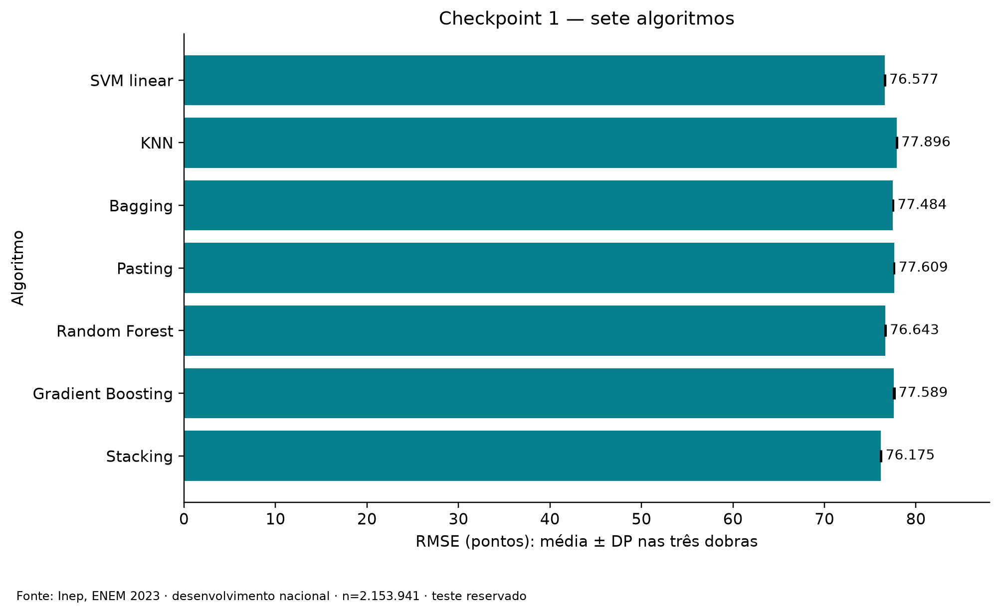
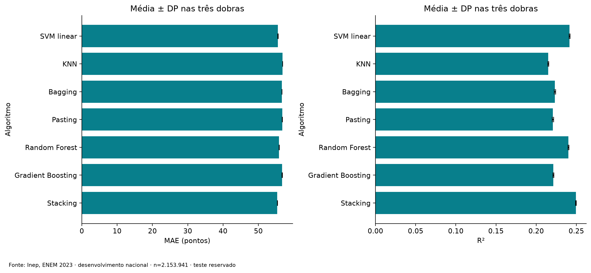
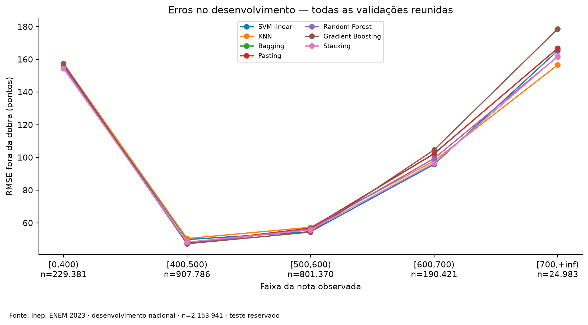

# Checkpoint 1 — comparação nacional dos sete algoritmos

Registro de 06/11/2026. **Checkpoint 1 concluído e validado: sete algoritmos e 21 avaliações nacionais.**
Os resultados abaixo usam exclusivamente o desenvolvimento. O Checkpoint 2 ainda não foi iniciado.

## O que o código está resolvendo

O projeto estima a nota de Ciências da Natureza (`NU_NOTA_CN`) no ENEM 2023 a partir
de características socioeconômicas, escolares e demográficas. É uma regressão
supervisionada. Não classifica aprovação, não processa redações e não estima efeitos
causais da renda ou da escola sobre o desempenho.

O contrato em `configs/ciencias_natureza.toml` especifica 40 entradas: Q005 é numérica
e as outras 39 são categóricas. Identificadores, notas de outras provas, presença,
gabaritos e respostas não entram como preditores. A imputação numérica pela mediana,+a padronização e a codificação one-hot são ajustadas somente no treino de cada dobra.
Ausências categóricas têm uma categoria explícita; categorias inéditas são ignoradas
pelo codificador. No stacking, cada estimador de base mantém seu próprio pipeline
também nas divisões internas.

As implementações e configurações estão em `src/enem_base/modeling.py`. O SVM é
LinearSVR; o boosting é GradientBoostingRegressor; o stacking combina regressão linear
e árvore por meio de Ridge. Bagging e pasting usam a mesma árvore e diferem na
amostragem com ou sem reposição. O KNN conserva 25 vizinhos e ponderação pela distância;
a implementação exata e sua conferência com dados reais estão descritas em
[checkpoints.md](checkpoints.md).

## Base de dados e população

| Verificação | Evidência observada |
|---|---:|
| Fonte nacional | 3.933.955 participantes, 76 colunas |
| IDs únicos | 3.933.955 |
| Registros fora de 2023 | 0 |
| Nota CN observada | 2.692.427 |
| Nota CN ausente, excluída apenas da supervisão | 1.241.528 |
| Zeros observados, preservados | 16.547 |
| Desenvolvimento | 2.153.941 |
| Teste reservado | 538.486 |

A base limpa foi recuperada integralmente do SQLite original encontrado no ambiente.
Seu SHA-256 coincide com o manifesto histórico; a integridade SQLite foi aprovada,
sem violações de chaves, e a recuperação comprovou a identidade dos participantes e
das dobras. As 79 partes Parquet têm hashes verificados antes de cada comparação.
Evidência da revalidação: `resultados/ciencias_natureza/evidencias/revalidacao_integral_2026-11-05.json`.

Isso sustenta a integridade e a cobertura da base limpa utilizada. O CSV bruto e o
ZIP completo não estão disponíveis nesta cópia; portanto, a conferência atual não
equivale a uma nova ingestão independente do arquivo bruto. Nenhum alvo ausente foi
imputado ou convertido em zero. Treineiros, faixas etárias e zeros foram mantidos.

## Comparabilidade e limites da interpretação

As três dobras persistidas usam KFold com embaralhamento e semente 42. Cada modelo
treina em 1.435.960 ou 1.435.961 participantes e valida em 717.981 ou 717.980. Cada
participante do desenvolvimento recebe uma avaliação fora do treino por modelo.
Os sete algoritmos usam as mesmas entradas e partições; não há amostragem para
substituir a comparação nacional.

RMSE é a métrica principal, com MAE e R² complementares. As tabelas apresentam a
média e o desvio padrão populacional (`ddof=0`) entre as três dobras. Esse desvio
descreve variação entre dobras; não é intervalo de confiança ou teste de significância.
Os parâmetros iniciais foram registrados antes da comparação. Sua busca pertence
às etapas seguintes, dentro do desenvolvimento.

Os resultados descrevem generalização dentro da população elegível do ENEM 2023,
sob divisão aleatória. Não demonstram generalização para outras edições, causalidade
ou adequação para decisões individuais. O diagnóstico de sobreajuste e subajuste
depende das curvas previstas no Checkpoint 3. O teste de 538.486 participantes continua
reservado para a avaliação final do Checkpoint 4.

Os tempos registrados são tempos de parede, com execução parcialmente concorrente.
Não são um benchmark isolado de velocidade. Interrupções e retomadas estão registradas
em [checkpoints.md](checkpoints.md); trabalho perdido antes da persistência não está
incluído nos tempos científicos publicados.

## Resultados das três dobras

Fonte: Inep, ENEM 2023; desenvolvimento nacional de 2.153.941 participantes. RMSE e MAE em pontos. Menores erros são melhores; maior R² é melhor. Não são resultados do teste final.

| Modelo | RMSE médio ± DP | MAE médio ± DP | R² médio ± DP | Tempo registrado (s) |
|---|---:|---:|---:|---:|
| SVM linear | 76,577 ± 0,059 | 55,519 ± 0,045 | 0,2414 ± 0,0005 | 46,2 |
| KNN | 77,896 ± 0,042 | 56,850 ± 0,025 | 0,2150 ± 0,0006 | 2681,7 |
| Bagging | 77,484 ± 0,029 | 56,657 ± 0,021 | 0,2233 ± 0,0009 | 1005,9 |
| Pasting | 77,609 ± 0,043 | 56,758 ± 0,032 | 0,2208 ± 0,0007 | 1253,9 |
| Random Forest | 76,643 ± 0,046 | 55,850 ± 0,029 | 0,2401 ± 0,0006 | 4615,4 |
| Gradient Boosting | 77,589 ± 0,068 | 56,730 ± 0,047 | 0,2212 ± 0,0005 | 535,0 |
| Stacking | 76,175 ± 0,049 | 55,356 ± 0,034 | 0,2494 ± 0,0005 | 1742,9 |

As 21 avaliações terminaram sem avisos de treinamento. Cada algoritmo avaliou todos os participantes do desenvolvimento uma vez fora do treino, nas mesmas três dobras. O CSV específico do checkpoint contém 21 registros de dobra e sete resumos.

## Interpretação dos resultados

O Stacking apresentou o menor RMSE médio (76,175), o menor MAE médio (55,356) e o maior R² médio (0,2494) entre as sete configurações. Isso descreve esta comparação inicial; não define o vencedor do teste final nem demonstra superioridade universal do algoritmo.

Como referência anterior, o baseline da média teve RMSE 87,921 e a regressão linear sem regularização, 76,484, nas mesmas partições. O Stacking reduziu o RMSE em cerca de 13,36% frente ao baseline, mas em apenas 0,309 ponto (0,40%) frente à linear. O aumento de complexidade produziu um ganho modesto frente a essa referência simples.

Bagging teve RMSE 77,484 e Pasting, 77,609, com a mesma árvore base. A diferença observada favoreceu a amostragem com reposição nesta configuração. SVM e Random Forest ficaram próximos: 76,577 e 76,643. Os desvios entre dobras são descritivos; não foi realizado teste de significância e não se deve afirmar equivalência ou superioridade estatística com base apenas nesses números.

Os erros são maiores nos extremos da distribuição. No Stacking, o RMSE foi 154,434 abaixo de 400 pontos (229.381 participantes), 48,229 entre 400 e 500 (907.786 participantes) e 161,881 a partir de 700 (24.983 participantes). O resíduo médio, definido como observado menos previsto, foi negativo na faixa abaixo de 400 e positivo a partir de 700: há superestimação média das notas baixas e subestimação média das altas.

O menor erro global não implica menor erro em toda faixa: o KNN obteve RMSE 156,586 a partir de 700 pontos, menor que o do Stacking nesse grupo, embora seu RMSE global tenha sido maior (77,896). Essa diferença reforça a necessidade de apresentar contagens e erros por faixa, além da média geral.

A Random Forest teve o maior tempo registrado (4.615,4 s); o SVM, o menor (46,2 s). Os tempos incluem a execução parcialmente concorrente documentada e não permitem uma comparação controlada de velocidade. As curvas do Checkpoint 3 serão necessárias para avaliar indícios de sobreajuste e subajuste.

## Arquivos entregues nesta etapa

- Código dos modelos: [modeling.py](../src/enem_base/modeling.py); KNN exato: [neighbors.py](../src/enem_base/neighbors.py).
- Execução e retomada: [executar_checkpoint1.py](../scripts/executar_checkpoint1.py) e [checkpointing.py](../src/enem_base/checkpointing.py).
- Validação e gráficos: [publicar_checkpoint1.py](../scripts/publicar_checkpoint1.py).
- Tabela comparativa: [comparacao_sete_modelos.csv](../resultados/ciencias_natureza/checkpoint-1-2026-11-06/publicacao-v2/comparacao_sete_modelos.csv).
- Registros por dobra e resumos: [experimentos.csv](../resultados/ciencias_natureza/checkpoint-1-2026-11-06/publicacao-v2/experimentos.csv).
- Manifesto validado: [checkpoint_validado.json](../resultados/ciencias_natureza/checkpoint-1-2026-11-06/publicacao-v2/checkpoint_validado.json).

As figuras estão em PNG a 220 dpi e SVG vetorial, com eixos, população e fonte identificados. A versão final é `publicacao-v2`; a primeira publicação foi preservada, mas sua legenda de erros por faixa sobrepunha pontos e foi corrigida.







## Validação e reprodução

O executor `scripts/executar_checkpoint1.py` preserva resultados concluídos e separa
os modelos em processos. `--resume` reutiliza somente dobras e blocos de previsões
cujos parâmetros, IDs, hashes e contexto sejam compatíveis. O KNN salva blocos reais
de 2.048 previsões; não cria previsões para preencher etapas pendentes.

```bash
.venv/bin/python -u scripts/executar_checkpoint1.py \
  --study configs/ciencias_natureza.toml \
  --output resultados/ciencias_natureza/checkpoint-1-2026-11-06 --resume
```

A publicação conferiu os 21 registros, hashes íntegros,
parâmetros registrados, igualdade das populações e recomposição das métricas gerais
a partir dos erros por grupo. O script recusa saídas existentes. O comando abaixo exige uma saída nova, sem refazer treinamentos:

```bash
.venv/bin/python scripts/publicar_checkpoint1.py \
  --study configs/ciencias_natureza.toml \
  --runs resultados/ciencias_natureza/checkpoint-1-2026-11-06 \
  --output resultados/ciencias_natureza/checkpoint-1-2026-11-06/publicacao-reproducao
```

A tentativa real de publicar com Random Forest ainda incompleta foi recusada sem criar saída (`validacao_bloqueio_publicacao.json`). Depois da conclusão, o publicador validou os sete modelos, recomposição das métricas a partir dos grupos e igualdade das contagens. A revisão visual das três figuras foi concluída após corrigir a legenda.

Lint, formatação, compilação, compatibilidade das dependências, lock e `git diff --check` foram aprovados. A primeira gravação do resumo de validação encontrou chaves `numpy.int64` não serializáveis em JSON; o comando diagnóstico foi corrigido para tipos nativos. Essa falha de registro não alterou os modelos ou suas métricas (`falha_registro_validacao.json`).

O [guia de validação manual](validacao-manual.md) detalha os demais comandos,
pré-requisitos e critérios de aprovação. Não foram criados arquivos de testes
automatizados nem dados fictícios nesta etapa.

A validação adicional do KNN recompôs RMSE, MAE e R² das três dobras a partir
dos 1.053 blocos de previsões salvos. Os IDs e hashes foram conferidos; os blocos
cobrem os 2.153.941 participantes do desenvolvimento e reproduzem as métricas
publicadas, com tolerância numérica de 10⁻¹². Evidência:
`resultados/ciencias_natureza/checkpoint-1-2026-11-06/validacao_previsoes_knn.json`.

## Próximo passo

Concluído este checkpoint, o Checkpoint 2 deverá comparar
os resultados e justificar a seleção dos três modelos. Essa seleção ainda não foi
iniciada. As buscas exigidas no enunciado devem ser compatibilizadas com essa etapa,
antes das curvas e da avaliação final. Artigo e PDFs finais continuam pendentes.
O fluxo existente congela e avalia uma solução, além de baseline e linear; ainda
precisa ser ampliado para as curvas e o teste dos três selecionados exigidos agora.
