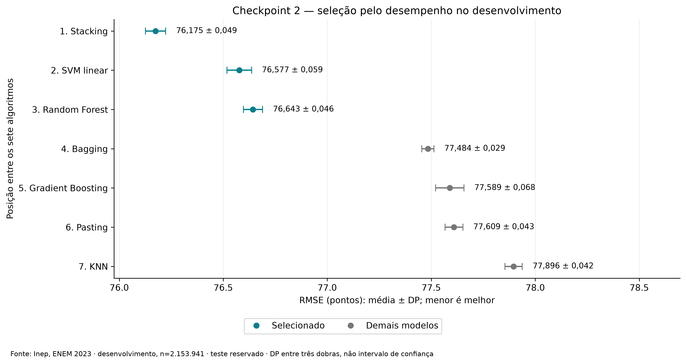
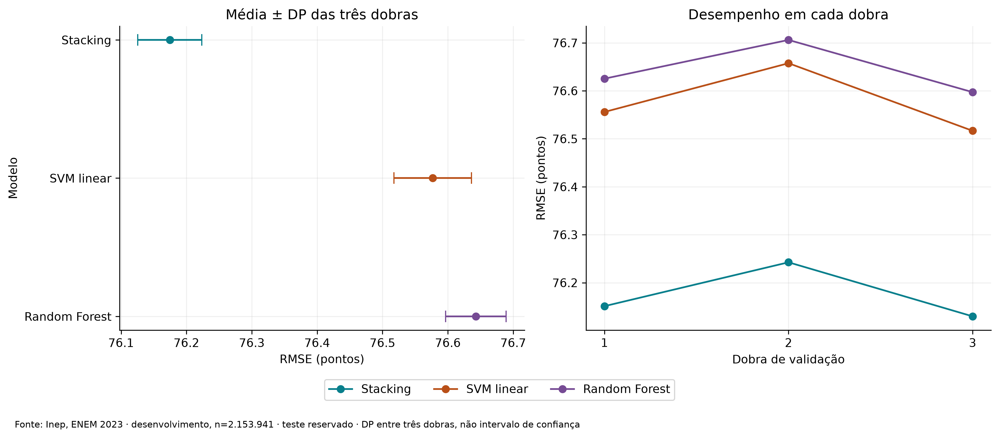

# Checkpoint 2 — seleção dos três melhores modelos

**Concluído e validado em 06/11/2026. Selecionados: Stacking, SVM linear e Random Forest.**

A seleção considera os sete algoritmos solicitados e avaliados no Checkpoint 1. O critério principal é o menor RMSE médio de validação cruzada. MAE e R² sustentam a análise; os tempos não decidiram a seleção. Foram reutilizadas as 21 avaliações reais, sem novo treinamento, busca de hiperparâmetros ou acesso aos alvos/preditores do teste.

## Critérios e população

- Desenvolvimento: 2.153.941 participantes do ENEM 2023, alvo NU_NOTA_CN e 40 entradas originais.
- Mesmas três dobras persistidas, com semente 42; 538.486 participantes continuam reservados para o teste.
- Ordenação pelo RMSE médio sem arredondamento; média e desvio padrão populacional (`ddof=0`) entre dobras.
- Desempates exatos: menor MAE, maior R² e identificador do modelo. Não houve empate exato no RMSE.
- Escopo: SVM, KNN, Bagging, Pasting, Random Forest, Gradient Boosting e Stacking. Baseline, linear, Ridge e árvore simples são referências externas a esta seleção.

Os hashes do Checkpoint 1, suas 21 avaliações, parâmetros, features e tamanhos das dobras foram conferidos. As médias e os desvios foram recalculados dos registros por dobra e comparados à publicação anterior. Nenhuma previsão ou métrica foi inventada para completar a seleção.

## Tabela comparativa completa

Fonte: Inep, ENEM 2023; validação cruzada no desenvolvimento. RMSE e MAE em pontos; menor é melhor. Maior R² é melhor. Os tempos são a soma dos tempos registrados nas três dobras do Checkpoint 1, com execução parcialmente concorrente; não são um benchmark isolado.

| Posição | Modelo | RMSE médio ± DP | MAE médio ± DP | R² médio ± DP | Tempo (s) | Selecionado |
|---:|---|---:|---:|---:|---:|:---:|
| 1 | Stacking | 76,175 ± 0,049 | 55,356 ± 0,034 | 0,2494 ± 0,0005 | 1742,9 | Sim |
| 2 | SVM linear | 76,577 ± 0,059 | 55,519 ± 0,045 | 0,2414 ± 0,0005 | 46,2 | Sim |
| 3 | Random Forest | 76,643 ± 0,046 | 55,850 ± 0,029 | 0,2401 ± 0,0006 | 4615,4 | Sim |
| 4 | Bagging | 77,484 ± 0,029 | 56,657 ± 0,021 | 0,2233 ± 0,0009 | 1005,9 | Não |
| 5 | Gradient Boosting | 77,589 ± 0,068 | 56,730 ± 0,047 | 0,2212 ± 0,0005 | 535,0 | Não |
| 6 | Pasting | 77,609 ± 0,043 | 56,758 ± 0,032 | 0,2208 ± 0,0007 | 1253,9 | Não |
| 7 | KNN | 77,896 ± 0,042 | 56,850 ± 0,025 | 0,2150 ± 0,0006 | 2681,7 | Não |

## Justificativa da seleção

**Stacking — primeiro.** Apresentou o menor RMSE (76,175), o menor MAE (55,356) e o maior R² (0,2494). Seu RMSE ficou 0,402 ponto abaixo do SVM, uma redução de aproximadamente 0,53%. Liderou as três dobras, com a configuração que combina linear e árvore por meio de Ridge.

**SVM linear — segundo.** RMSE de 76,577, MAE de 55,519 e R² de 0,2414. Ficou à frente da Random Forest nas três dobras. A diferença média de RMSE é pequena: 0,066 ponto. Seu menor tempo registrado é uma observação adicional, sem substituir o critério de desempenho ou constituir benchmark controlado.

**Random Forest — terceiro.** RMSE de 76,643, MAE de 55,850 e R² de 0,2401. Ficou 0,841 ponto de RMSE abaixo do Bagging, o primeiro excluído, uma redução de aproximadamente 1,09%. A vantagem sobre o Bagging ocorreu nas três dobras, de 0,818 a 0,857 ponto.

Bagging, Gradient Boosting, Pasting e KNN tiveram RMSE médio maior que os três selecionados. O mesmo trio e a mesma ordem foram obtidos ao ordenar as médias por MAE e por R². A decisão não depende de escolher a métrica que favorece um modelo diferente.

## Consistência nas dobras e limites

| Dobra de validação | Stacking | SVM linear | Random Forest |
|---:|---:|---:|---:|
| 1 | 76,151 | 76,556 | 76,625 |
| 2 | 76,243 | 76,658 | 76,706 |
| 3 | 76,130 | 76,517 | 76,597 |

A tabela mostra RMSE em pontos. A apresentação usa dobras 1, 2 e 3; os arquivos técnicos conservam os índices 0, 1 e 2. A ordem Stacking → SVM → Random Forest foi observada nas três dobras. As nove diferenças entre cada selecionado e Bagging foram conferidas diretamente nos registros originais.

Essa consistência é descritiva. Os desvios entre três dobras não são intervalos de confiança; não foi realizado teste de significância. Portanto, não se afirma superioridade estatística, equivalência entre modelos ou desempenho garantido em outra edição do ENEM. O resultado descreve configurações iniciais avaliadas no desenvolvimento; ainda não define o vencedor do teste final.

O Checkpoint 1 mostrou erros maiores nos extremos de nota e que o KNN pode ter menor erro na faixa a partir de 700, embora tenha maior erro global. O critério desta etapa permanece o RMSE global previamente definido; a análise por faixa deve acompanhar as próximas avaliações.

## Escopo solicitado e catálogo ampliado

A seleção acima é especificamente entre os sete algoritmos pedidos. A regressão linear (RMSE 76,483799) e Ridge (76,483610), já avaliadas nas mesmas partições, têm RMSE menor que SVM e Random Forest. Ao ordenar todos os dez regressores iniciais, excluindo apenas o baseline, as três primeiras posições seriam Stacking, Ridge e linear. Esse diagnóstico está em `diagnostico_catalogo_ampliado.csv` e não substitui o trio solicitado.

Essa diferença precisa permanecer visível: o enunciado original pede buscas nos três melhores regressores da comparação inicial ampla. O comando legado `search` usa esse catálogo ampliado e selecionaria automaticamente outro trio. Nenhuma busca foi executada neste checkpoint e esse requisito acadêmico continua pendente. A adaptação das próximas etapas deve respeitar o escopo explícito da seleção e documentar a compatibilização com o enunciado, sem declarar que a seleção dos sete já cumpre a busca exigida.

## Gráficos e arquivos produzidos

Os gráficos foram inspecionados visualmente e estão disponíveis em PNG a 300 dpi e SVG vetorial. O gráfico por dobra não é uma curva de aprendizado: seu eixo horizontal identifica as três validações já executadas, não tamanhos de treinamento.





- [Ranking completo em CSV](../resultados/ciencias_natureza/checkpoint-2-2026-11-06/ranking_sete_modelos.csv).
- [Tabela dos três selecionados](../resultados/ciencias_natureza/checkpoint-2-2026-11-06/tres_selecionados.csv).
- [Seleção e configurações iniciais em JSON](../resultados/ciencias_natureza/checkpoint-2-2026-11-06/selecionados.json).
- [Ranking por dobra](../resultados/ciencias_natureza/checkpoint-2-2026-11-06/ranking_por_dobra.csv) e [margens frente ao primeiro excluído](../resultados/ciencias_natureza/checkpoint-2-2026-11-06/margens_por_dobra.csv).
- [Referências fora do escopo](../resultados/ciencias_natureza/checkpoint-2-2026-11-06/referencias_fora_do_escopo.csv) e [diagnóstico do catálogo ampliado](../resultados/ciencias_natureza/checkpoint-2-2026-11-06/diagnostico_catalogo_ampliado.csv).
- [Manifesto com proveniência e hashes](../resultados/ciencias_natureza/checkpoint-2-2026-11-06/manifesto.json) e [validações executadas](../resultados/ciencias_natureza/checkpoint-2-2026-11-06/validacao.json).
- Código: [selection.py](../src/enem_base/selection.py) e [selecionar_checkpoint2.py](../scripts/selecionar_checkpoint2.py).

## Reprodução e validação

Pré-requisitos: ambiente instalado pelo lock, Checkpoint 1 concluído e arquivos reais disponíveis. Executar a partir da raiz do repositório. Comando utilizado:

```bash
.venv/bin/python scripts/selecionar_checkpoint2.py \
  --study configs/ciencias_natureza.toml \
  --checkpoint1 resultados/ciencias_natureza/checkpoint-1-2026-11-06 \
  --references resultados/ciencias_natureza/cv-recuperado-v2 \
  --output resultados/ciencias_natureza/checkpoint-2-2026-11-06
```

Para reproduzir, escolher um diretório novo de saída. Uma execução sobre a saída existente foi realmente tentada e recusada; o manifesto e seus artefatos permaneceram íntegros. Não é necessário repetir os treinamentos do Checkpoint 1.

Verificações executadas: recomposição independente das médias e desvios das 21 avaliações; identidade do trio entre métricas e dobras; nove margens pareadas; leitura do contrato por `load_selection`; hashes das entradas e saídas; recusa de sobrescrita; inspeção visual dos dois gráficos; parsing dos SVGs; lint, formatação, compilação, compatibilidade de dependências e `git diff --check`. Não foram criados arquivos de testes automatizados nem dados fictícios.

Critério de aprovação: trio Stacking/SVM/Random Forest derivado dos registros reais, sete candidatos, 21 dobras verificadas, mesmos dados e parâmetros, `test_evaluated=false` e artefatos íntegros. Divergências de hash, saída existente ou Checkpoint 1 incompleto devem interromper a seleção, sem editar manifestos para forçar aprovação.

## Próximo checkpoint

Checkpoint 3: curvas de aprendizado e análise dos três selecionados. A função `load_selection(config, caminho)` fornece as configurações registradas para o novo fluxo e verifica o contrato. O fluxo legado congela apenas uma solução e precisará de adaptação para trabalhar com esse trio.

As configurações deste registro são as iniciais do Checkpoint 1; não são hiperparâmetros otimizados nem a solução final congelada. As buscas do enunciado continuam pendentes, e configurações alteradas posteriormente precisarão de diagnósticos correspondentes antes do teste. Curvas, avaliação final, artigo e PDFs ainda não foram executados neste checkpoint.
