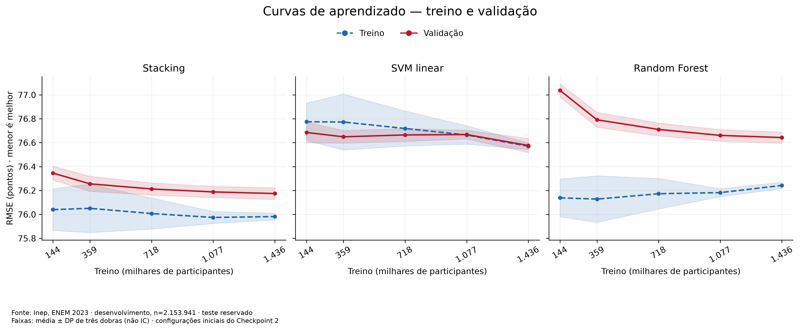
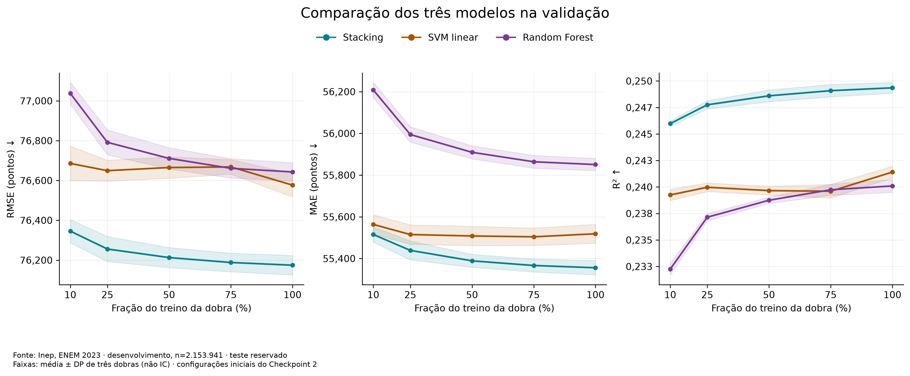
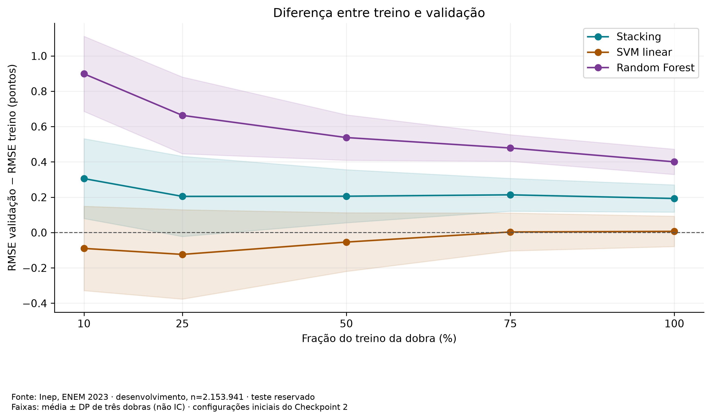

# Checkpoint 3 — curvas de aprendizado dos três modelos

**Concluído e validado em 07/11/2026.** Os 45 ajustes foram executados em 06/11/2026;
a publicação numérica foi concluída no mesmo dia e a inspeção visual e o fechamento
foram realizados em 07/11. São três modelos, três dobras e cinco tamanhos de treino,
com métricas reais de treino e validação. Não foi iniciada a avaliação final no teste.

## Metodologia e código executado

A seleção validada do [Checkpoint 2](checkpoint-2-resultados.md) forneceu **Stacking,
SVM linear e Random Forest**, no escopo dos sete algoritmos solicitados. Foram mantidas
as 40 entradas originais, o alvo `NU_NOTA_CN` e as configurações estatísticas iniciais.
As buscas de hiperparâmetros do enunciado permanecem pendentes; estas curvas não são
resultados de modelos otimizados por busca.

O desenvolvimento nacional contém **2.153.941 participantes** do ENEM 2023. Em cada
dobra, os mesmos 717.980 ou 717.981 participantes são usados na validação em todos
os tamanhos e modelos. Os demais são permutados por `RandomState(42)`; os prefixos
de 10%, 25%, 50%, 75% e 100% formam subconjuntos cumulativos. Os índices selecionados
voltam à ordem da fonte antes do ajuste. **100% é todo o treino daquela dobra**,
não todo o desenvolvimento. O teste de **538.486 participantes** continua reservado.

Todo o pipeline é reajustado em cada subconjunto, inclusive imputação, padronização
e codificação. O Stacking usa linear e árvore como bases, Ridge como combinador e
três dobras internas com pipelines próprios. As métricas de treino são calculadas
aplicando o modelo ajustado ao próprio subconjunto; não são as métricas das previsões
internas fora da dobra do Stacking.

A Random Forest utiliza seis trabalhadores, contra dois na configuração de referência.
Essa diferença operacional está explícita em `protocolo.json`; os parâmetros
estatísticos foram preservados. A conferência prévia produziu árvores idênticas e
previsões equivalentes dentro da precisão numérica. Os pontos em 100% também
reproduziram o Checkpoint 1. Detalhes no [protocolo](checkpoint-3-protocolo.md).

Código efetivamente utilizado:

- [Implementação das curvas e da retomada](../src/enem_base/learning_curves.py).
- [Executor do Checkpoint 3](../scripts/executar_checkpoint3.py).
- [Validação e publicação das tabelas e figuras](../scripts/publicar_checkpoint3.py).

## Resultados das curvas

RMSE de validação, em pontos da nota: média ± desvio padrão populacional (`ddof=0`)
de três dobras. Valores menores são melhores. O DP é descritivo, não um intervalo
de confiança. Os arquivos CSV mantêm a precisão completa.

| Treino | Participantes por dobra | Stacking | SVM linear | Random Forest |
|---|---:|---:|---:|---:|
| 10% | 143.596 | 76,346 ± 0,058 | 76,686 ± 0,087 | 77,037 ± 0,055 |
| 25% | 358.990 | 76,256 ± 0,063 | 76,649 ± 0,053 | 76,791 ± 0,063 |
| 50% | 717.980 | 76,213 ± 0,050 | 76,665 ± 0,054 | 76,711 ± 0,054 |
| 75% | 1.076.970 | 76,188 ± 0,047 | 76,668 ± 0,036 | 76,661 ± 0,049 |
| 100% | 1.435.960–1.435.961 | 76,175 ± 0,049 | 76,577 ± 0,059 | 76,643 ± 0,046 |

No treino completo da dobra:

| Modelo | RMSE treino ± DP | RMSE validação ± DP | MAE validação ± DP | R² validação ± DP | RMSE validação − treino |
|---|---:|---:|---:|---:|---:|
| Stacking | 75,982 ± 0,028 | 76,175 ± 0,049 | 55,356 ± 0,034 | 0,2494 ± 0,0005 | 0,193 |
| SVM linear | 76,570 ± 0,027 | 76,577 ± 0,059 | 55,519 ± 0,045 | 0,2414 ± 0,0005 | 0,007 |
| Random Forest | 76,242 ± 0,026 | 76,643 ± 0,046 | 55,850 ± 0,029 | 0,2401 ± 0,0006 | 0,400 |

A diferença entre treino e validação é calculada por dobra e depois resumida.
Os pontos com 100% são novos ajustes, com métricas de treino calculadas nesta etapa;
as métricas anteriores não foram copiadas para preencher as curvas.

| Modelo | Redução do RMSE de 10% a 100% | Redução de 75% a 100% | Diferença treino/validação: 10% → 100% | Ajuste + avaliação dos 15 pontos (min) |
|---|---:|---:|---:|---:|
| Stacking | 0,171 | 0,014 | 0,306 → 0,193 | 95,92 |
| SVM linear | 0,109 | 0,091 | -0,090 → 0,007 | 3,81 |
| Random Forest | 0,394 | 0,018 | 0,899 → 0,400 | 95,62 |

As reduções se referem ao RMSE médio de validação. Os tempos somam apenas ajustes
e avaliações concluídos e registrados. Houve famílias simultâneas e uma interrupção;
trabalho perdido antes de ser salvo, carregamento da base e intervalos sem execução
não entram nesses valores. Eles não constituem benchmark isolado de velocidade.

## Interpretação: ajuste e generalização

**Stacking:** apresentou o menor RMSE médio nos cinco tamanhos, além do menor MAE e
maior R² médios em cada tamanho. O RMSE de validação caiu de 76,346 para 76,175, enquanto
a diferença média entre validação e treino caiu de 0,306 para 0,193 ponto. Há uma pequena
vantagem do erro de treino sobre o de validação, mas não um grande afastamento entre
as curvas. O ganho de 75% a 100% foi de apenas 0,014 ponto, sinalizando estabilização
no intervalo observado. Com 10% do treino, seu RMSE de validação foi numericamente
menor que o dos outros dois modelos com 100%; isso descreve este experimento, sem
constituir prova de superioridade universal ou de menor custo computacional.

**SVM linear:** treino e validação praticamente coincidem em 100%: 76,570 e 76,577,
respectivamente. A redução de 10% a 100% foi de 0,109 ponto e a curva não foi
estritamente monótona. Não se observa grande separação típica de overfitting neste
intervalo. A proximidade das curvas e o ganho limitado são compatíveis com uma
limitação da configuração ou da representação linear, isto é, possível underfitting;
porém, não distinguem essa hipótese de informação ausente ou variabilidade não
explicada nas notas. Diferenças médias negativas nas frações menores foram preservadas:
não se forçou que o erro de validação fosse sempre maior que o de treino.

**Random Forest:** apresentou a maior redução total de RMSE (0,394 ponto) e a maior
diferença média entre treino e validação. Essa diferença diminuiu de 0,899 para 0,400
ponto com mais dados, comportamento compatível com redução do componente de variância.
Esse padrão sugere maior componente de sobreajuste no confronto entre treino e
validação, sem quantificar sua variância estatística. Não indica overfitting severo:
a diferença final permanece pequena frente ao RMSE de aproximadamente 76,6 pontos. O ganho de 75% a 100% foi de 0,018 ponto.
Em 75%, ficou numericamente à frente da SVM por cerca de 0,007 ponto; em 100%, a SVM
voltou à segunda posição. Essa diferença estreita não foi tratada como significativa.

**Comparação e limites:** o Stacking mantém a melhor média de validação nas configurações
avaliadas. As curvas usam a quantidade de exemplos no eixo horizontal, não épocas
ou iterações. O menor treino já contém 143.596 pessoas; o experimento não caracteriza
o regime de poucas amostras. R² de validação de aproximadamente 0,240 a 0,249 no treino completo
indica que parte substancial da variação das notas permanece sem explicação, mas
não identifica sozinha sua causa. Os parâmetros de capacidade das árvores ficaram
fixos; as curvas não medem o efeito de ajustar profundidade, folha mínima ou outros
hiperparâmetros.

A interpretação considera a relação entre erros de treino e validação e sua evolução
com o tamanho do conjunto, conforme a [documentação de curvas de aprendizado do
scikit-learn](https://scikit-learn.org/stable/modules/learning_curve.html). As mesmas
dobras foram utilizadas para selecionar o trio no Checkpoint 2; estas métricas são
uma análise interna, não uma estimativa final independente. Não foram realizados
ensaios de significância, avaliação temporal em outro ano ou teste de generalização
para estados totalmente ausentes do treino. O Checkpoint 4 permanece necessário.

## Gráficos verificados

As três figuras foram inspecionadas visualmente em PNG e fornecidas também em SVG.
Possuem títulos, eixos, legendas, fonte e indicação do significado das faixas.
Os PNGs têm 300 dpi; os SVGs são vetoriais. As linhas conectam os cinco tamanhos
medidos; as faixas mostram média ± DP das três dobras.

[Versão SVG das curvas](../resultados/ciencias_natureza/checkpoint-3-2026-11-06/publicacao/curvas_aprendizado_rmse.svg).

[Versão SVG da comparação](../resultados/ciencias_natureza/checkpoint-3-2026-11-06/publicacao/comparacao_validacao.svg).

[Versão SVG da diferença entre erros](../resultados/ciencias_natureza/checkpoint-3-2026-11-06/publicacao/lacuna_generalizacao.svg).

## Validações e evidências

- 45 pontos únicos e 15 resumos completos, sem avisos de treinamento ou previsão.
- Mesmos participantes entre modelos e validação fixa; os quinze subconjuntos foram
  reconstruídos independentemente dos IDs persistidos, conferindo composição cumulativa,
  separação de treino/validação e hashes. Nenhum alvo do teste foi carregado.
- Nove avaliações em 100% reproduziram o Checkpoint 1. A maior diferença absoluta
  entre as métricas publicadas foi 7,105 × 10⁻¹⁵, abaixo da tolerância de 10⁻⁸.
- Médias e desvios recompostos independentemente dos 45 registros; tabelas e pontos
  vinculados aos parâmetros, código, dependências, partições e origem por hashes.
- Métricas recompostas com NumPy a partir dos modelos salvos dos três algoritmos,
  usando todo o treino e toda a validação do primeiro ponto (10%, dobra 0).
  Diferença máxima: 4,263 × 10⁻¹⁴. A previsão em blocos também foi comparada à chamada
  única em 2.048 registros reais, com diferença máxima de 2,274 × 10⁻¹³.
- Retomada da SVM reutilizou quinze pontos sem novo ajuste e sem modificar arquivos.
  Após a interrupção, a retomada das outras famílias preservou os 32 pontos existentes;
  98 arquivos anteriores tiveram seus hashes SHA-256 conferidos. Os dois manifestos de estado
  foram atualizados durante a execução, como previsto.
- Publicação incompleta e tentativa de sobrescrever publicação existente recusadas.
  Três PNGs inspecionados; dimensões, resolução, texto dos SVGs e hashes conferidos.
- Ruff, formatação dos arquivos novos, compilação Python, dependências e `git diff --check`
  aprovados. Nenhum arquivo novo de testes automatizados foi criado; a suíte sintética
  legada não foi executada.
- O consolidado anterior conserva suas 72 linhas e seu hash. Os 45 pontos de curvas
  ficam separados; não são misturados às comparações iniciais nem ao teste final.

Arquivos principais:

| Artefato | Conteúdo |
|---|---|
| [curvas_por_dobra.csv](../resultados/ciencias_natureza/checkpoint-3-2026-11-06/publicacao/curvas_por_dobra.csv) | 45 registros, métricas de treino/validação, IDs por hash, tempos e avisos |
| [curvas_resumo.csv](../resultados/ciencias_natureza/checkpoint-3-2026-11-06/publicacao/curvas_resumo.csv) | 15 médias e desvios, com tamanhos reais |
| [evolucao_modelos.csv](../resultados/ciencias_natureza/checkpoint-3-2026-11-06/publicacao/evolucao_modelos.csv) | Ganhos de RMSE, diferenças entre erros e tempos |
| [reproducao_checkpoint1.csv](../resultados/ciencias_natureza/checkpoint-3-2026-11-06/publicacao/reproducao_checkpoint1.csv) | Nove comparações com o Checkpoint 1 |
| [validacao.json](../resultados/ciencias_natureza/checkpoint-3-2026-11-06/validacao.json) | Conferência final e referências às evidências |
| [checkpoint.json](../resultados/ciencias_natureza/checkpoint-3-2026-11-06/checkpoint.json) | Encerramento, hashes do relatório, publicação e validação |

Os comandos de preparação, execução e retomada estão no
[protocolo](checkpoint-3-protocolo.md); a publicação está detalhada no
[guia de validação manual](validacao-manual.md). Uma nova reprodução deve usar outra
pasta. Os modelos ajustados ficam locais, fora do Git, em `modelos_ajustados/`.

## Próxima etapa e pendências

O próximo checkpoint solicitado é a avaliação final dos três modelos. Antes de abrir
o teste, precisam ser resolvidas as buscas e o congelamento das configurações, com
escopo explícito: os três do catálogo ampliado do enunciado não coincidem integralmente
com o trio dos sete algoritmos solicitado. Caso as configurações sejam alteradas após
as buscas, suas curvas correspondentes também deverão ser produzidas antes da avaliação
final. O Checkpoint 3 aqui concluído cobre as configurações iniciais selecionadas.

O teste, as visualizações finais dependentes dele, o artigo ABNT e os PDFs de
acompanhamento e pitch continuam pendentes. Este relatório não é o artigo final nem
comprova a entrega dos PDFs. Não houve commit, push ou publicação externa nesta etapa.
