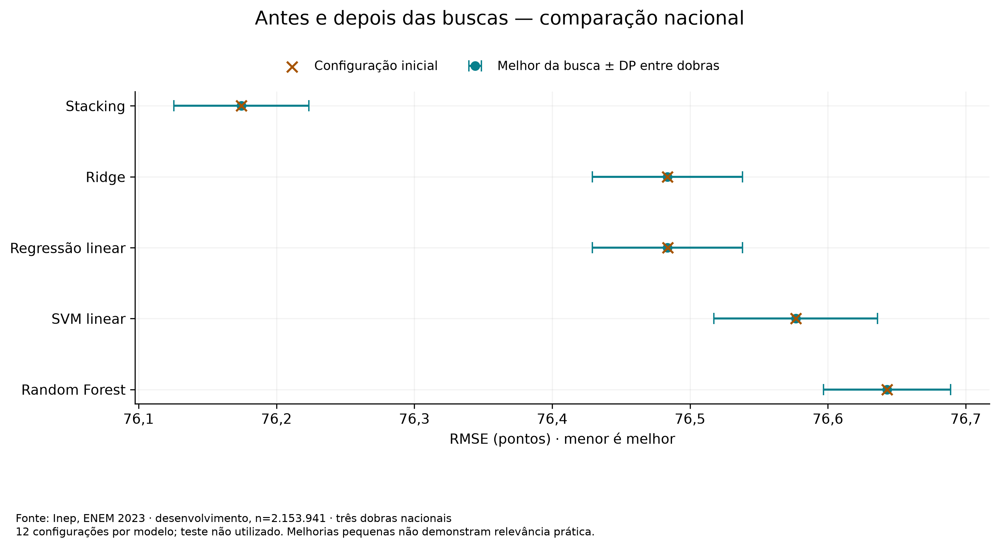
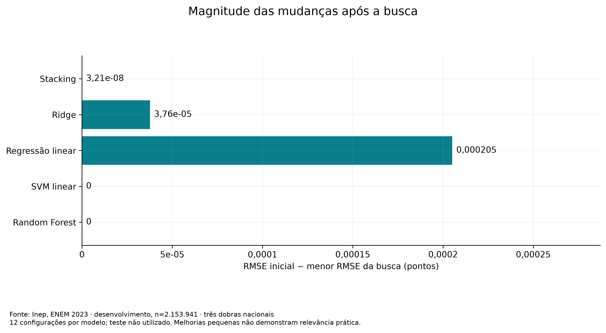

# Checkpoint 4 — buscas concluídas e seleção anterior ao teste

Resultados nacionais de 07/11/2026. Esta etapa está concluída e validada;
o encerramento do Checkpoint 4 ainda depende das curvas finais e da avaliação
do teste. Este relatório não contém métricas de teste.

## Escopo e execução

Foram concluídas cinco buscas reais com `GridSearchCV`, cada uma com 12
configurações e três dobras persistidas: **60 configurações e 180 avaliações**.
Todas utilizam os 2.153.941 participantes do desenvolvimento, as mesmas 40 entradas
e transformações aprendidas apenas no treino de cada dobra. O teste de 538.486
participantes ficou reservado durante toda a seleção.

A união dos escopos resolve uma pendência do projeto: o trio entre os sete algoritmos
solicitados é Stacking, SVM e Random Forest; o trio do catálogo ampliado do enunciado
é Stacking, Ridge e linear. Foram ajustados os cinco, sem substituir silenciosamente
o trio solicitado. As grades e o mecanismo de cache constam no
[protocolo](checkpoint-4-protocolo.md).

O reaproveitamento de árvores e bases fixas foi conferido contra ajustes diretos em
dados reais. As previsões OOF do Stacking foram calculadas com pipelines próprios nas
dobras internas. Portanto, 180 avaliações não significam 180 treinamentos independentes
de todos os componentes: há cálculos compartilhados e ajustes verificados do CP3.

## Antes e depois

RMSE em pontos, média das três dobras. Os valores completos estão no CSV; a seleção
não arredondou os resultados.

| Modelo | RMSE inicial | Melhor RMSE da busca | Redução de RMSE | Parâmetro da melhor configuração |
|---|---:|---:|---:|---|
| Stacking | 76,174515932 | 76,174515900 | 0,000000032052 | alpha=1.000 no Ridge combinador |
| SVM linear | 76,576689738 | 76,576689738 | 0 | C=1; epsilon=0 |
| Random Forest | 76,642872389 | 76,642872389 | 0 | 30 árvores; profundidade 12 |
| Linear | 76,483799178 | 76,483594152 | 0,000205025968 | intercepto ativado; tol=10⁻⁵ |
| Ridge | 76,483609815 | 76,483572174 | 0,000037640529 | alpha=10 |

As buscas não demonstraram melhoria prática relevante. Em particular, a diferença do
Stacking é cerca de 3,2 × 10⁻⁸ ponto, muito menor que seu DP entre dobras de 0,048868.
Isso não constitui evidência de superioridade estatística do novo alpha. O protocolo
registrou antecipadamente a retenção da configuração inicial para melhorias de até
10⁻⁸; como a diferença ultrapassou esse limite numérico, foi adotado alpha=1.000.
O limite não é um teste de significância nem uma margem de relevância prática.

SVM e Random Forest conservaram as configurações iniciais. O teto de 50.000 iterações
usado na busca da SVM não melhorou suas métricas frente ao ajuste inicial convergido;
a receita final manteve max_iter=5.000. Na linear, tol altera a precisão do solucionador,
não a regularização. Não se infere ótimo global fora dos intervalos pesquisados.

| Melhor da busca | RMSE ± DP | MAE ± DP | R² ± DP |
|---|---:|---:|---:|
| Stacking | 76,174516 ± 0,048868 | 55,355652 ± 0,034433 | 0,249355 ± 0,000510 |
| Ridge | 76,483572 ± 0,054379 | 55,622979 ± 0,040001 | 0,243252 ± 0,000488 |
| Linear | 76,483594 ± 0,054384 | 55,623029 ± 0,039982 | 0,243252 ± 0,000488 |
| SVM linear | 76,576690 ± 0,059360 | 55,518540 ± 0,045403 | 0,241408 ± 0,000543 |
| Random Forest | 76,642872 ± 0,046135 | 55,850498 ± 0,029102 | 0,240096 ± 0,000607 |

O DP é populacional entre três dobras (`ddof=0`), não um intervalo de confiança.
RMSE é o critério principal; MAE e R² são complementares. Por isso, a SVM ter MAE
menor que linear/Ridge não muda a ordenação principal por RMSE.

## Congelamento das receitas

A seleção confrontou os modelos originais, os melhores das cinco buscas e as variantes
já executadas: engenharia, seleção, PCA em dois regressores, ponderação e duas ablações.
O Stacking manteve o menor RMSE. O Ridge com engenharia, por exemplo, teve RMSE 76,457959,
maior que o Stacking. A seleção não utilizou resultados do teste.

Foram congelados cinco modelos para os mesmos IDs de teste:

- Stacking: bases linear e árvore, com Ridge combinador alpha=1.000.
- SVM linear: configuração inicial, C=1, epsilon=0, max_iter=5.000.
- Random Forest: configuração inicial, 30 árvores, profundidade 12; seis trabalhadores
  como configuração de execução, com equivalência previamente verificada.
- Baseline: média do alvo aprendida no desenvolvimento completo.
- Regressão linear de referência: configuração original sem regularização, tol=10⁻⁶.

O Stacking também é a solução acadêmica escolhida no catálogo ampliado, portanto não
é necessário duplicar seu ajuste como um sexto modelo. A linear otimizada e o Ridge
otimizado permanecem resultados válidos das buscas; não substituem a referência linear
original exigida pelo protocolo. A ordem observada no teste será descritiva e não
autorizará nova escolha de hiperparâmetros.

## Verificações e custo

As métricas das **180 avaliações foram recalculadas a partir das previsões reais**
e comparadas aos resultados brutos do `GridSearchCV`, aos CSVs por dobra e às médias
e desvios. Foram verificados parâmetros, hashes, três dobras por configuração,
populações nacionais e ausência de avisos. O resultado foi aprovado.

| Busca | Tempo de parede observado na busca (s) |
|---|---:|
| Stacking | 1.599,26 |
| SVM | 883,12 |
| Random Forest | 984,64 |
| Linear | 940,51 |
| Ridge | 676,24 |

Esses tempos incluem cálculos compartilhados, cache e concorrência de processos;
não são benchmark isolado de velocidade nem uma soma de custos independentes por
configuração. SVM, linear e Ridge foram executados sequencialmente no mesmo processo;
Random Forest e Stacking iniciaram em processos próprios.

## Figuras e arquivos

- [Comparação numérica](../resultados/ciencias_natureza/checkpoint-4-2026-11-07/publicacao_buscas-v2/antes_depois.csv).
- [Todas as configurações](../resultados/ciencias_natureza/checkpoint-4-2026-11-07/publicacao_buscas-v2/todas_configuracoes.csv).
- [Receitas congeladas](../resultados/ciencias_natureza/checkpoint-4-2026-11-07/congelamento/receitas.json).
- [Todos os candidatos considerados](../resultados/ciencias_natureza/checkpoint-4-2026-11-07/congelamento/candidatos.json).
- [Conferência das 180 avaliações](../resultados/ciencias_natureza/checkpoint-4-2026-11-07/validacao_buscas.json).
- [Validação visual](../resultados/ciencias_natureza/checkpoint-4-2026-11-07/validacao_visual_buscas.json).

A publicação `publicacao_buscas-v2` contém PNG de 300 dpi e SVG. A primeira versão
foi preservada; sua legenda sobrepunha um ponto e foi corrigida na versão indicada.

## Próxima etapa

Concluir e conferir as curvas das receitas congeladas. Depois, reajustar os cinco
modelos nos 80% completos e avaliar uma única execução persistente do teste reservado.
Código: [seleção](../src/enem_base/final_selection.py),
[curvas finais](../src/enem_base/frozen_curves.py) e
[avaliação final](../src/enem_base/final_evaluation.py).
