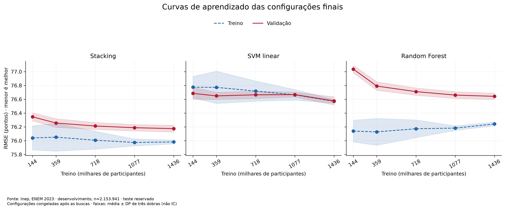
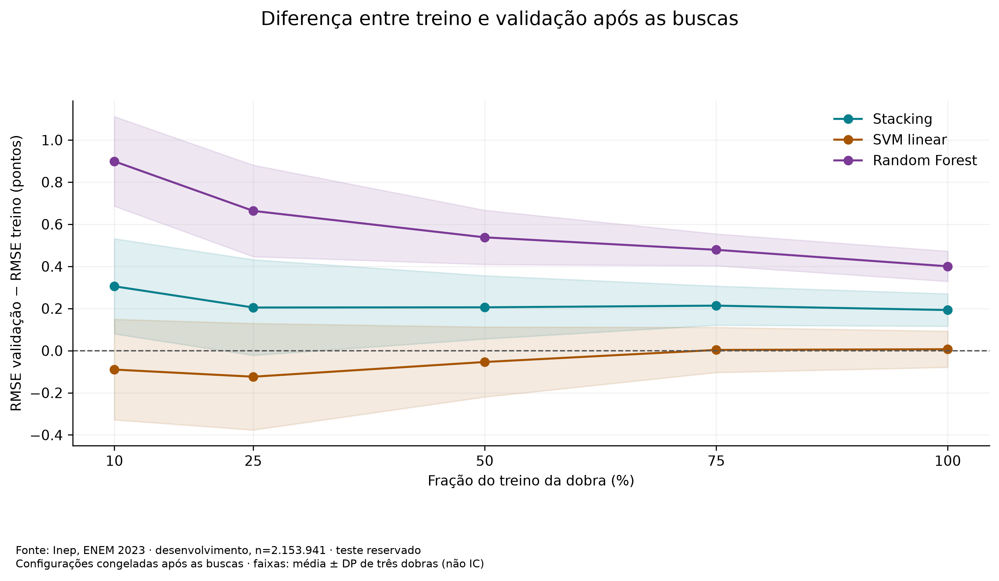

# Checkpoint 4 — curvas das configurações congeladas

Etapa concluída e validada em 07/11/2026, antes da abertura do teste.
As [buscas](checkpoint-4-buscas.md) fixaram as receitas; estas curvas não foram
usadas para escolher novos hiperparâmetros.

Foram conferidos **45 pontos**: três modelos, cinco frações e três dobras.
Cada modelo usa os mesmos IDs dos subconjuntos cumulativos do Checkpoint 3,
preservando a ordem da fonte. As frações de 10%, 25%, 50%, 75% e 100% referem-se
ao treino da dobra, não à base nacional nem ao teste.

## Execução e reaproveitamento

- **30 pontos de SVM e Random Forest:** pesos do Checkpoint 3 reutilizados com
  parâmetros idênticos e hashes verificados; métricas de treino e validação
  recalculadas. Suas buscas não mudaram as receitas.
- **12 pontos parciais de Stacking:** bases previamente ajustadas nos mesmos
  subconjuntos, novas previsões OOF internas com preparação própria por dobra e
  novo ajuste do combinador Ridge com alpha=1.000. O alpha=1 foi recomposto e
  confrontado com o modelo anterior antes da mudança.
- **Três pontos integrais de Stacking:** ajustes da configuração selecionada na
  busca reutilizados; métricas de treino e validação calculadas para a curva.

São 45 pontos reais validados, sem alegar 45 novos treinamentos completos de todos
os componentes. Nenhuma transformação reutilizada foi aprendida fora do treino
correspondente. Os arquivos permitem verificar origem, parâmetros e participantes.

## Resultados

| Modelo | RMSE treino, 100% | RMSE validação, 100% | Validação − treino |
|---|---:|---:|---:|
| Stacking | 75,981694 | 76,174516 | 0,192821 |
| SVM linear | 76,569974 | 76,576690 | 0,006716 |
| Random Forest | 76,242479 | 76,642872 | 0,400393 |

Valores médios nas três dobras; RMSE em pontos.

| Fração do treino da dobra | Stacking: RMSE validação | SVM: RMSE validação | Random Forest: RMSE validação |
|---|---:|---:|---:|
| 10% | 76,345578 | 76,685593 | 77,037262 |
| 25% | 76,255758 | 76,649195 | 76,791477 |
| 50% | 76,212790 | 76,664998 | 76,710883 |
| 75% | 76,188105 | 76,668011 | 76,661000 |
| 100% | 76,174516 | 76,576690 | 76,642872 |

O Stacking manteve o menor RMSE médio nos cinco tamanhos. Sua alteração de alpha
não mudou o diagnóstico na precisão apresentada. A Random Forest reduziu o erro
de validação e a diferença entre treino e validação conforme aumentou a amostra.
A SVM apresentou pequenas oscilações; aumentar o subconjunto não produziu melhora
monótona. Em algumas frações, seu RMSE médio de treino superou o de validação.
Esse sinal isolado não comprova vazamento; os IDs e o ajuste das transformações
foram verificados.

Os gaps finais pequenos não indicam sobreajuste acentuado nessas configurações.
As curvas mostram ganhos limitados no intervalo estudado, cujo menor treino já
tem 143.596 participantes. Não se deve extrapolar seu comportamento para amostras
muito menores. R² próximo de 0,24–0,25, por si só, não comprova subajuste: também
há informação ausente nas entradas e variabilidade das notas não explicada pelo
perfil observado. Não foi demonstrado que mais dados ou maior complexidade
necessariamente resolveriam essa limitação.

Esta é uma avaliação interna de desenvolvimento. A generalização ao teste
reservado será examinada após o reajuste completo. A divisão aleatória do ENEM
2023 não demonstra generalização para outro ano ou uma população externa.

## Gráficos e evidências

As faixas mostram média ± desvio populacional entre três dobras, não intervalos de
confiança. Os PNG de 300 dpi e SVG foram conferidos visualmente.

- [45 pontos por dobra](../resultados/ciencias_natureza/checkpoint-4-2026-11-07/publicacao_curvas_finais/curvas_por_dobra.csv).
- [15 resumos com médias e desvios](../resultados/ciencias_natureza/checkpoint-4-2026-11-07/publicacao_curvas_finais/curvas_resumo.csv).
- [Validação numérica](../resultados/ciencias_natureza/checkpoint-4-2026-11-07/validacao_curvas_finais.json).
- [Código das curvas](../src/enem_base/frozen_curves.py) e [publicador](../scripts/publicar_curvas_checkpoint4.py).

Foram conferidos hashes, contextos, receitas, IDs, contagens, arquivos por ponto,
métricas finitas e ausência de avisos. Os pontos em 100% reproduziram as métricas
de validação das receitas congeladas. O próximo passo é concluir os reajustes
nos 2.153.941 participantes de desenvolvimento e avaliar o teste reservado.
