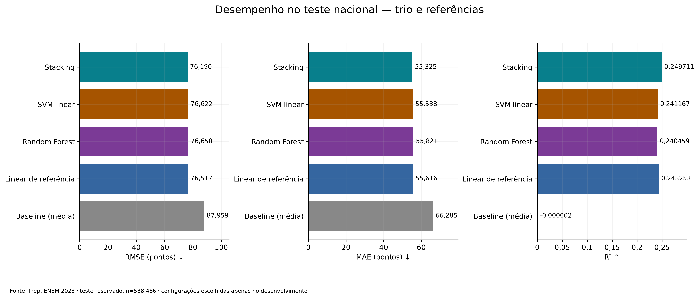
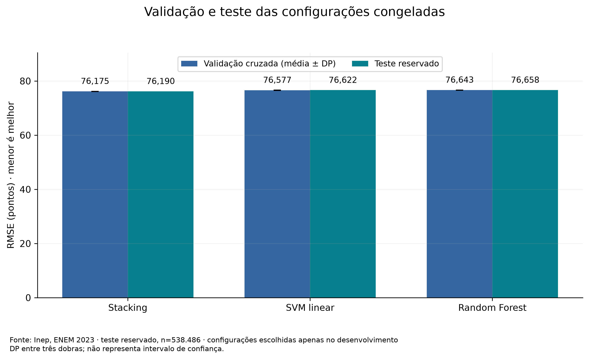
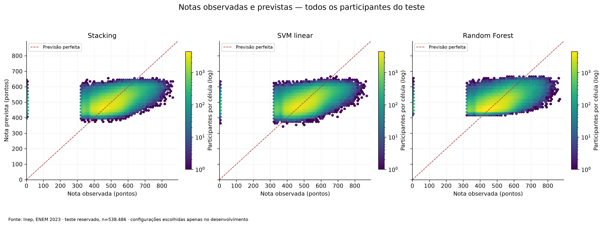
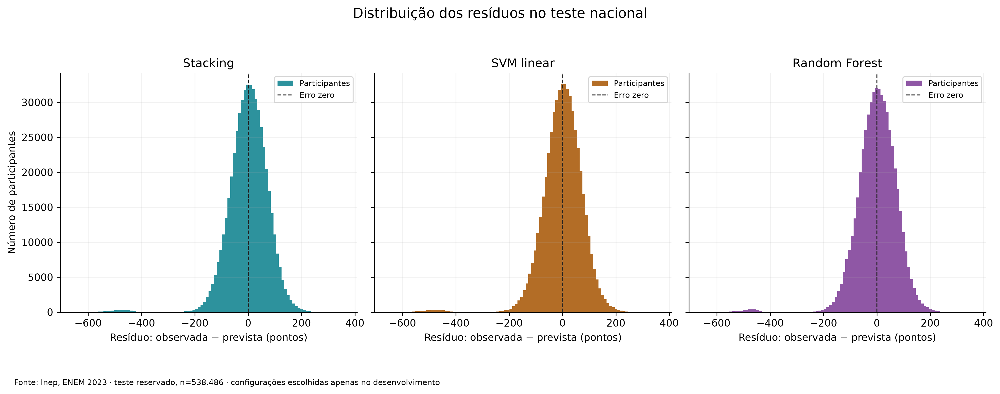
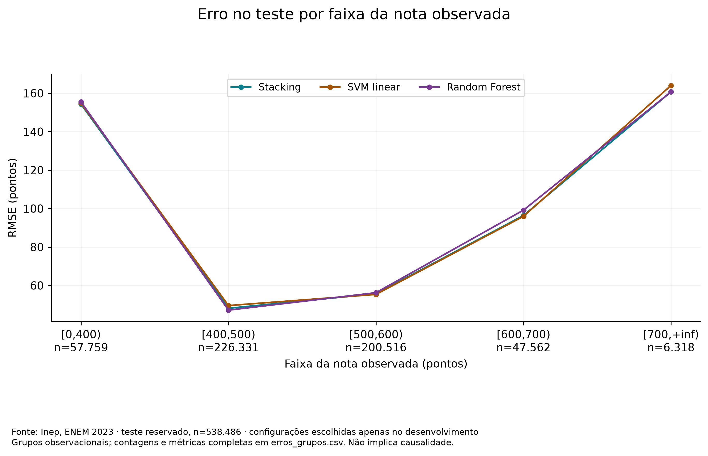

# Checkpoint 4 — avaliação final nacional

Resultados executados e validados em 07/11/2026. Alvo: nota de Ciências da Natureza (NU_NOTA_CN), ENEM 2023. As buscas, as curvas finais e os pesos foram fixados antes de abrir o teste. Não houve nova escolha de hiperparâmetros após o teste.

**Stacking teve o menor RMSE entre os três algoritmos selecionados no teste:** 76,190 pontos. A solução acadêmica escolhida anteriormente no desenvolvimento é Stacking. A ordenação de teste descreve esta divisão; não é uma demonstração de superioridade universal ou significância estatística.

## Dados e protocolo efetivamente usados

A fonte recuperada contém 3.933.955 participantes. Foram excluídos da supervisão 1.241.528 sem a nota alvo, mantendo 2.692.427 elegíveis. Notas ausentes não viraram zero.
O desenvolvimento teve **2.153.941 participantes** e o teste reservado, **538.486**. O teste inclui 3.311 notas zero, mantidas na avaliação.

Foram preservados a divisão 80/20 com semente 42, as três dobras e os IDs persistidos. Os três modelos e a linear usam as 40 entradas originais de perfil e questionário. IDs, outras notas, respostas, gabaritos e presença não entram nos preditores. O baseline aprende somente a média do alvo no desenvolvimento.

Cada pipeline foi reajustado nos 80% completos antes de carregar o teste. Todos os modelos previram os mesmos participantes, sem amostragem e sem limitar artificialmente as previsões à faixa das notas. Uma trava persistente permite apenas retomar os mesmos pesos e a mesma identidade da avaliação.

## Pendências metodológicas resolvidas

- Cinco buscas reais cobriram a união do trio solicitado e do trio do catálogo ampliado: 60 configurações, 180 avaliações nacionais e zero avisos. [Resultados e interpretação](checkpoint-4-buscas.md).
- A seleção comparou originais, buscas e variantes obrigatórias, sem usar o teste.
- As curvas das receitas congeladas foram concluídas: 45 pontos, zero avisos e reprodução da validação em 100%. [Análise e gráficos](checkpoint-4-curvas.md).
- O fluxo agora avalia o trio, o baseline e a linear de referência, com pesos persistidos e retomada verificada. A solução acadêmica coincide com um dos três, portanto não foi duplicada como outro modelo.

## Métricas no teste

| Modelo | RMSE ↓ | MAE ↓ | R² ↑ | Treino (s) | Previsão (s) |
|---|---:|---:|---:|---:|---:|
| Stacking | 76,190 | 55,325 | 0,249711 | 1.250,63 | 4,40 |
| Linear de referência | 76,517 | 55,616 | 0,243253 | 36,41 | 2,08 |
| SVM linear | 76,622 | 55,538 | 0,241167 | 20,63 | 2,19 |
| Random Forest | 76,658 | 55,821 | 0,240459 | 1.280,05 | 2,53 |
| Baseline (média) | 87,959 | 66,285 | -0,000002 | 0,00 | 0,00 |

RMSE e MAE estão em pontos; R² é adimensional. Os tempos são de parede observados sob compartilhamento de recursos, não um benchmark isolado.
O vencedor do trio reduziu o RMSE em 11,770 pontos (13,38%) frente ao baseline nesta divisão.

## Validação cruzada e teste

| Modelo | RMSE médio CV | RMSE teste | Teste − CV |
|---|---:|---:|---:|
| Stacking | 76,175 | 76,190 | 0,015 |
| SVM linear | 76,577 | 76,622 | 0,045 |
| Random Forest | 76,643 | 76,658 | 0,015 |

A linear de referência teve RMSE menor que SVM linear, Random Forest. Isso reforça a importância de manter as referências: o ranking do trio solicitado não é o mesmo que o ranking de todo o catálogo.

A comparação de CV usa treino de aproximadamente 1,436 milhão por dobra; o teste usa modelos reajustados em 2,154 milhões. Diferenças entre CV e teste também refletem composição da partição e tamanho de treino. Não foram calculados intervalos de confiança nem testes de significância para essas diferenças.

## Erros por faixa e por grupo

A tabela apresenta os erros de Stacking. Resíduo = nota observada − prevista; resíduo médio positivo indica subestimação média, e negativo, superestimação.

| Faixa observada | Participantes | RMSE | MAE | Resíduo médio |
|---|---:|---:|---:|---:|
| [0,400) | 57.759 | 154,310 | 118,596 | -118,595 |
| [400,500) | 226.331 | 48,117 | 37,705 | -25,540 |
| [500,600) | 200.516 | 55,665 | 46,134 | 36,985 |
| [600,700) | 47.562 | 96,393 | 87,706 | 87,544 |
| [700,+inf) | 6.318 | 160,742 | 156,034 | 156,034 |

Na faixa abaixo de 400, o resíduo médio foi -118,595 pontos; na faixa a partir de 700, foi 156,034. Os RMSE dessas faixas foram 154,310 e 160,742, respectivamente, frente ao RMSE global de 76,190. A média global, portanto, oculta erros maiores nos extremos; o desempenho não é uniforme entre as faixas de nota.

Também foram calculados erros por tipo de escola (TP_ESCOLA), UF de aplicação (SG_UF_PROVA) e renda familiar (Q006), com contagens. Cada estratificação cobre todo o teste. Os grupos são observacionais; diferenças não demonstram causalidade nem determinam a capacidade individual dos participantes.

## Gráficos

Os gráficos usam todos os participantes avaliados e estão disponíveis em PNG de 300 dpi e SVG. As densidades de observado versus previsto compartilham os mesmos limites, células e escala de cores. Por se tratar de regressão, foram usados resíduos e erros por faixa/grupo em vez de matrizes de confusão.

## Limites e análise crítica

As curvas finais apresentam gaps pequenos entre treino e validação, sem sinal de sobreajuste acentuado nas configurações avaliadas. O erro remanescente e o R² não comprovam, isoladamente, subajuste: o perfil disponível não contém toda a informação relacionada ao desempenho. As buscas trouxeram mudanças muito pequenas; o ajuste do alpha do Stacking não demonstrou ganho prático.

A avaliação cobre o ENEM 2023 elegível em uma divisão aleatória nacional. Não demonstra generalização temporal para outro ENEM nem para populações externas. Uma única partição de teste não mede toda a incerteza da comparação.

A base limpa SQLite e os 79 Parquets foram conferidos por hashes e preservados. O CSV bruto e o ZIP original continuam ausentes nesta cópia; a recuperação usa o banco previamente validado. Essa limitação de proveniência documental permanece explícita, sem inventar um novo arquivo bruto.

## Código, evidências e reprodução

- [Previsões reais de todos os modelos](../resultados/ciencias_natureza/checkpoint-4-2026-11-07/avaliacao_final/previsoes_teste.csv).
- [Métricas finais, parâmetros e proveniência](../resultados/ciencias_natureza/checkpoint-4-2026-11-07/avaliacao_final/experimentos.csv).
- [Todos os erros por grupo e contagens](../resultados/ciencias_natureza/checkpoint-4-2026-11-07/avaliacao_final/erros_grupos.csv).
- [Receitas fixadas antes do teste](../resultados/ciencias_natureza/checkpoint-4-2026-11-07/congelamento/receitas.json).
- [Validação das previsões e recomposição das métricas](../resultados/ciencias_natureza/checkpoint-4-2026-11-07/validacao_teste.json).
- [Revisão visual da publicação](../resultados/ciencias_natureza/checkpoint-4-2026-11-07/validacao_visual_teste.json).
- [Todos os gráficos e tabelas finais](../resultados/ciencias_natureza/checkpoint-4-2026-11-07/publicacao-v2).

Executores: [buscas](../scripts/executar_buscas_checkpoint4.py), [congelamento/curvas/ajustes/teste](../scripts/executar_checkpoint4.py) e [publicação final](../scripts/publicar_checkpoint4.py). Os comandos e critérios estão no [protocolo](checkpoint-4-protocolo.md).

Foram executadas verificações de integridade, cobertura e métricas sobre os dados reais, além de lint, compilação e conferência do ambiente. Não foram criados arquivos de testes automatizados ou resultados fictícios. Os arquivos dos Checkpoints 1–3 permanecem preservados; as 72 linhas do consolidado inicial não foram misturadas com as buscas e curvas. Os resultados finais estão identificados separadamente como `test_final`.

## Próximos checkpoints

O próximo passo é o Checkpoint 5: organizar a coleção final de visualizações e sua integração aos entregáveis. Depois vêm o artigo ABNT (Checkpoint 6) e os PDFs de acompanhamento e pitch (Checkpoint 7). Esses entregáveis ainda não são declarados concluídos. Não houve commit, push ou publicação externa.
